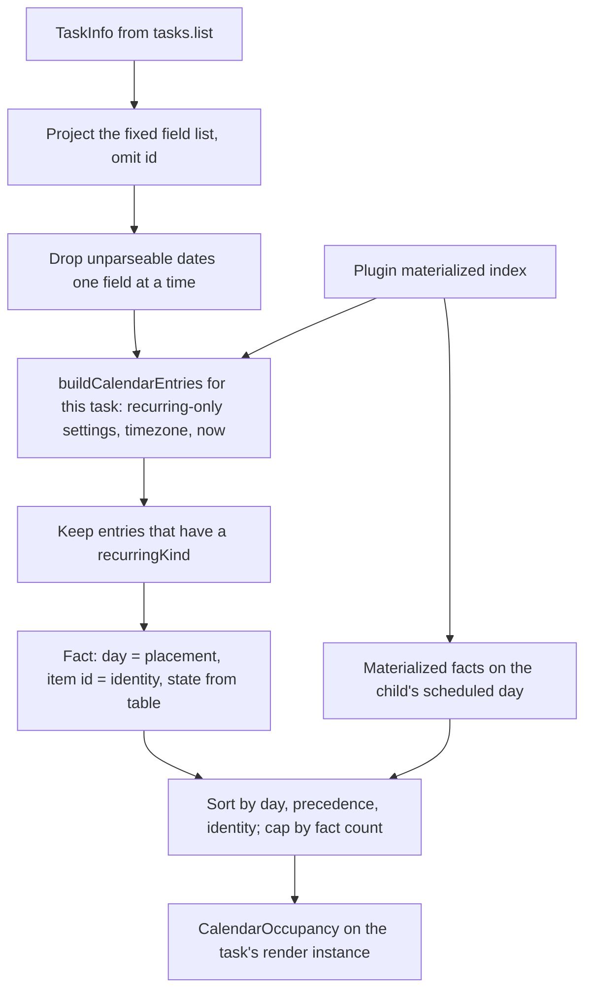
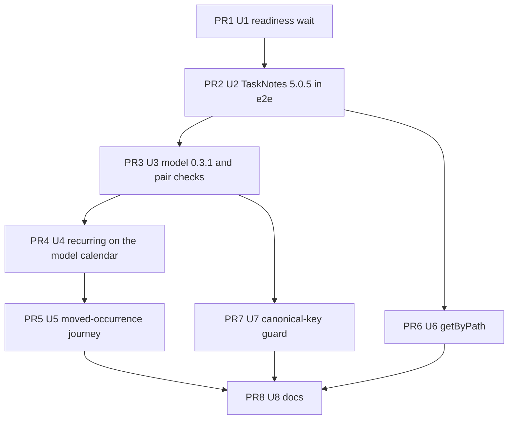

# Keep up with TaskNotes 5.0.5 - Plan

## Goal Capsule

- **Objective:** A user on stock TaskNotes 5.0.5 sees the same recurring-task days in the Gantt as in their TaskNotes calendar, and every Gantt read and edit keeps working, with the end-to-end suite proving it against 5.0.5. Two edit behaviours change on purpose: a grid column whose property is a TaskNotes-owned field becomes read-only (R9), and a date edit on a recurring task is recorded the way TaskNotes records it (R10).
- **Means:** Pin the e2e suite and the bundled `@tasknotes/model` to TaskNotes 5.0.5's versions, with checks that keep the two paired (KTD1, KTD2), and derive recurring occurrences from the model calendar that TaskNotes itself draws with (KTD3).
- **Authority:** This plan, then `AGENTS.md`, then `docs/engineering/practices.md`. On any question about TaskNotes behaviour, TaskNotes source at tag `5.0.5` and the `@tasknotes/model` 0.3.1 it ships decide.
- **Execution profile:** Eight PRs, one per unit, merged on green in this order: PR1, PR2, PR6, PR3, PR7, PR4, PR5, PR8 (AGENTS.md landing cadence). The write-safety PRs, PR6 and PR7, land before the recurring PRs because they close data-loss paths: a failed lookup that overwrites dependency edges, and generic writes to fields TaskNotes 5 owns. A session ends at its first merged PR.
- **Stop conditions:** Stop the unit and hand over when a 5.0.5 e2e failure traces to a plugin defect outside the unit (fix it in its own PR first), when the model's fixtures show TaskNotes behaviour no KTD covers, or when a change would touch a ranked-defect file (Ranked-file statement).
- **Who finishes:** Agent sessions through `ce-work`, one unit each; the maintainer intervenes by exception.

---

## Product Contract

### Summary

The plugin moves its verified TaskNotes baseline from 4.11.0 to stock 5.0.5. The e2e suite installs 5.0.5 and the plugin bundles the model library 5.0.5 ships. Recurring tasks are expanded by the same model calendar function the TaskNotes calendar uses, which brings v5's moved occurrences. Lookups move off the deprecated `tasks.get`, and generic property edits stop writing to fields TaskNotes 5 owns.

### Problem Frame

TaskNotes is the Gantt's system of record, and the Gantt has only been tested against TaskNotes 4.11.0 (`test/wdio/wdio.conf.mts`, `test/wdio/wdio.perf.conf.mts`). TaskNotes 5.0.5 is current and already runs in the maintainer's vaults. Render checks on 2026-11-25 and 2026-11-26 found no break, but they exercised nothing beyond rendering.

Recurring tasks are where the two diverge. `src/datasource/calendarItems/recurringSource.ts` claims parity "by construction" with the TaskNotes calendar by re-running the 4.11 calendar's read path over `@tasknotes/model` 0.2.1. TaskNotes has drawn its calendar with the model's own calendar function since 4.15.0 (TaskNotes commit `1d409727`), so the claim is stale.

Since 4.15.0 (TaskNotes commit `87677f11`), TaskNotes records a rescheduled next occurrence as a moved occurrence. `scheduled` holds the new day, `recurrence_original_date` holds the rule date, and the occurrence shows once, on the new day. `TaskService.updateTask` applies this to any `scheduled` change on a recurring task, so a date edit in the Gantt creates one. The Gantt does not read the property, so for users on TaskNotes 4.15 and later it likely draws such a task on both days today.

Two write-path gaps arrive with v5. `CANONICAL_TASKINFO_KEYS` in `src/controller/propertyPatchResolution.ts` is a hand-kept list that misses `attachments`, `assignees` and `recurrence_original_date`, and 5.0.5 deletes an `attachments` value that is not a list (`src/services/task-service/taskUpdatePlanning.ts:483-485` at tag 5.0.5). And `tasks.get`, called at four sites, is deprecated.

### Requirements

**Verified against TaskNotes 5.0.5**

- R1. The functional and perf e2e suites install stock TaskNotes 5.0.5, and their readiness wait fails when TaskNotes' readiness member is missing, so a green run is evidence.
- R2. The plugin bundles exactly the `@tasknotes/model` version TaskNotes 5.0.5 ships, and a check fails when the tested TaskNotes and the bundled model stop matching.

**Recurring tasks match the TaskNotes calendar**

- R3. For a recurring task, the Gantt shows the same occurrence days and states as the TaskNotes 5.0.5 calendar under the same three toggles: show recurring, show completed, show skipped.
- R4. A moved occurrence shows once, on the day it was moved to, and its original rule date stays its identity for completed and skipped state. Google-calendar moved dates suppress their original days the same way.
- R5. When two occurrences of one task fall on the same day, both are kept, and the day shows the higher-precedence state.
- R6. A materialized occurrence's marker on the parent row sits on the day its note is scheduled, falling back to its `occurrence_date`.
- R7. An unparseable date drops only that date, as in TaskNotes; the rest of the task still renders.

**Writes stay safe on TaskNotes 5**

- R8. Task lookups use `tasks.getByPath` when TaskNotes offers it and `tasks.get` otherwise. A dependency write whose lookup finds no task writes nothing.
- R9. A generic property edit never writes to a field TaskNotes 5.0.5 treats as its own, and the cell editor offers no editor for a column the write path would refuse.
- R10. Editing a recurring task's dates in the Gantt passes the new `scheduled` to `tasks.update` unchanged; TaskNotes decides what the move means.

**Compatibility statement**

- R11. Users on TaskNotes 4.11 through 4.x keep a working Gantt for reading, editing and dependencies. Recurring placement follows 5.0.5 rules, and the docs say it may differ from their 4.x calendar.
- R12. The docs name 5.0.5 as the verified TaskNotes version, and source comments in the files this plan edits carry no TaskNotes version stamps. The stamp in `src/controller/GanttController.ts` is deferred (Deferred to Follow-Up Work).

### Key Decisions

- **Target stock TaskNotes 5.0.5.** (session-settled: user-approved — chosen over the maintainer's fork build, `renatomen/tasknotes` branch `dogfood`: stock is what other users install, and CI cannot reach a build that exists on one machine.) Governs R1, R2, R3.
- **5.0.5 is the parity baseline; 4.x keeps working, but its recurring placement may differ.** (session-settled: user-approved — chosen over keeping the bundled model at the version the minimum supported TaskNotes ships: that rule holds the Gantt on pre-4.15 calendar semantics.) This plan supersedes that rule, stated in `docs/plans/2026-08-03-001-feat-calendar-view-union-plan.md` in its model-pin decision and U4 step 4. Governs R2, R11, R12.
- **The version check runs in tests, not in the product.** (session-settled: user-approved — chosen over an in-product warning: a 4.x user would see it every session with nothing to act on.) Governs R2.
- **TaskNotes decides what a date edit on a recurring task means.** TaskNotes is the system of record and every write goes through its API (STRATEGY.md § Our approach), so the Gantt neither re-interprets nor overrides it. Governs R10.
- **A materialized marker follows its note's placement.** The TaskNotes calendar draws a materialized occurrence on its note's `scheduled` day and a moved virtual occurrence on its moved day; the Gantt follows both. Governs R6.
- **`minAppVersion` stays 1.10.0.** (session-settled: user-approved — chosen over raising it to TaskNotes 5's 1.13.1: the plugin also works without TaskNotes.) Governs R11.

### Success Criteria

- The functional and perf e2e suites pass against stock TaskNotes 5.0.5, locally and in CI.
- Every scenario with recurring entries in the model's shipped calendar fixtures (`@tasknotes/model/calendar/fixtures`: 34 scenarios and 11 moved-occurrence fixtures) yields, through the Gantt's adapter, the occupancy days and states its expected entries imply.
- The U3 PR states how much `main.js` grew with the model bump.

### Scope Boundaries

- Out: the fork's dependency fields (relationship-typed blocking, status categories, per-endpoint blocking). Anything that might use them stays optional.
- Out: switching task identity from file path to v5's `TaskInfo.id`.
- Out: detecting new TaskNotes releases automatically.
- Out: matching TaskNotes' Agenda and completion calendar, which still call `generateRecurringInstances` directly in 5.0.5.
- Considered, not built: an in-product version-mismatch warning (Key Decisions). Users confused by 4.x recurring differences would change this.
- Considered, not built: a separate visual state, or "moved from" hover text, for moved occurrences. The TaskNotes calendar shows a moved occurrence as an ordinary next occurrence, and parity argues for the same.
- Considered, not built: `createCalendarEntryIndex` caching (KTD3). A slow U4 timing on multi-year windows would change this.

#### Deferred to Follow-Up Work

- Under TaskNotes 4.15 and later, a dependency cascade or subtree shift that moves a recurring successor creates a moved occurrence on it; shipped releases already do this. Whether the Gantt should skip or confirm such successors is a product question; U8 records it in the backlog.
- `src/controller/GanttController.ts:2301` cites "TaskNotes (4.11.0)" in a comment. The file is ranked 4, so the stamp goes with the next plan that touches the file for its own reasons.

### Sources

- TaskNotes at tag `5.0.5` (fork checkout `../tasknotes`, machine-local):
  - `src/bases/calendarModelEvents.ts`: projection field list, `withValidDates`, materialized map.
  - `src/bases/CalendarView.ts`: timezone, clock and toggle context.
  - `src/services/task-service/recurringMoveIdentity.ts` and `src/services/TaskService.ts:694`: moved-occurrence capture on update.
  - `docs/features/recurring-tasks.md` § Rescheduling a virtual occurrence.
  - `src/api/TaskNotesAPI.ts:733`: `model.info()` reports `specVersion` only.
  - `src/settings/defaults.ts:376`: `enableMdbaseSpec: true`.
- `@tasknotes/model` 0.3.1: README § Calendar contract, `dist/types/calendar.d.ts`, `dist/esm/calendar.js` (`buildTaskEntries`, `buildCalendarEntries`).
- Learnings to read before the matching unit:
  - U1, U2: `docs/solutions/developer-experience/gate-e2e-on-cold-index-before-measuring-render.md`, `docs/solutions/integration-issues/starter-note-steals-active-leaf-e2e-flake.md`, `docs/solutions/developer-experience/wdio-runtime-behavior-needs-a-real-run.md`.
  - U4: `docs/solutions/best-practices/assert-the-claim-not-the-mechanism.md`, `docs/solutions/architecture-patterns/a-guard-that-restates-its-subject-names-a-missing-seam.md`, `docs/solutions/logic-errors/all-day-event-boundaries-floating-not-instant.md`.
  - U6: `docs/solutions/integration-issues/tasknotes-status-palette-wrong-api-path.md`, `docs/solutions/integration-issues/tasknotes-custom-field-write-top-level-key.md`.
  - U3, U7: `docs/solutions/best-practices/derive-the-member-list-from-keyof-not-a-runtime-probe.md`, `docs/solutions/workflow-issues/state-the-rule-derive-the-list.md`, `docs/solutions/best-practices/a-test-name-is-a-claim-verify-the-mutation.md`.
- Research dossiers with line references (machine-local, best effort; a missing dossier does not block): `C:\Users\renat\AppData\Local\Temp\compound-engineering-197609\ce-plan-research\ca574a7a\` — `api-diff.md`, `framework-docs.md`, `repo-research.md`, `learnings.md`, `spec-flow.md`.
- The handoffs that started this work (untracked): `docs/handoffs/2026-11-25-tasknotes-v5-compatibility-handoff.md`, `docs/handoffs/2026-11-26-tasknotes-5.0.5-update-handoff.md`.

---

## Planning Contract

### Key Technical Decisions

- KTD1. **Bundle `@tasknotes/model` at exactly 0.3.1.** That is TaskNotes 5.0.5's pin, and parity means running the code TaskNotes runs; 0.3.2's contents are unverified. Governs R2.
- KTD2. **One committed pin file pairs the TaskNotes version with its model version, and two checks hold the pair.** (session-settled: user-approved — chosen over a runtime check in the product, per Key Decisions.) Both WDIO configs read the file with `fs`; neither imports an `.mts` module, because `wdio.perf.conf.mts`'s header records loader fragility there. A jest test asserts that `package.json`'s exact `@tasknotes/model` dependency equals the pin. An e2e assertion compares TaskNotes' `api.model.info().specVersion` with the bundled `TASKNOTES_SPEC_VERSION` (`"0.3.0-rc.6"` in 0.3.1). Known limit: `model.info()` reports no package version, so two model releases that share one spec string pass the e2e check. Governs R2.
- KTD3. **Derive recurring occurrences with `buildCalendarEntries`, called once per task.** It is the core the TaskNotes calendar runs. `createCalendarEntryIndex` is rejected: it is a cache keyed on object identity, which the plugin's pure derivation does not need. Rebuilding from `generateRecurringInstances` is rejected: it would re-implement the identity, moved-day and look-back logic inside the model's `buildTaskEntries`, which is the drift this plan removes. One call per task keeps a bad task from failing the batch. Settings pass the three recurring toggles through and turn every other output off (`showScheduled`, `showDue`, `showTimeEntries`, `showScheduledToDueSpan`, `showOverdueOnToday`), and only entries with a `recurringKind` are kept. Governs R3, R4.
- KTD4. **Mirror TaskNotes 5.0.5's host adapter, not only the model call.** The model throws on any invalid date. TaskNotes' `calendarModelEvents.ts` projects a fixed field list and drops unparseable dates one field or list item at a time (`withValidDates`, which also accepts `YYYY-MM-DD HH:mm`). The plugin mirrors both and omits `id` from the projection, so the model's task id is the path. It keeps its own `isRealCalendarDay` guard on `scheduled`. The `TaskNotesTaskInfo` slice in `src/datasource/TaskNotesSource.ts` widens to the fields the projection forwards, including `recurrence_original_date`, `googleCalendarMovedOriginalDates` and `googleCalendarExceptionOriginalScheduled`. Governs R3, R7.
- KTD5. **An occupancy fact's `day` is the placement; its identity rides in the item id.** Placement is the local civil day of `entry.start` in the context timezone, found with the exported `calendarDateToInstant` and `calendarInstantToDate`. Identity is `entry.instanceDate`, used as the `makeCalendarItemId` qualifier. `CalendarOccupancy` keeps its shape, so `GanttController.occupancyEqual` needs no change. Governs R4.
- KTD6. **Every same-day fact is emitted, in a total order that lets the strongest state win.** The renderer keeps the last fact per day (`src/render/segmentLayout.ts`: "later runs win each day"). Facts sort by placement day, then by the precedence in the state table below, then by identity. Precedence ranks how concrete a fact is: a recorded completion or skip is something the user did, a materialized note is a real file, a next occurrence is a pending commitment, and a projection is a guess. Completed ranks above skipped, as in the current engine's recorded-state check. The per-series cap `MAX_OCCUPANCY_DAYS_PER_SERIES` counts facts, not days, and keeps the latest facts in sort order, as the current engine does (`slice(-MAX_OCCUPANCY_DAYS_PER_SERIES)`). Governs R5.
- KTD7. **The plugin keeps its own materialized index and uses it twice.** The model has no materialized entry kind; it only suppresses those days on the parent. The plugin's index feeds the model as `materializedOccurrences`, keyed by parent path. It also emits the `materialized` facts, placed on the child's valid `scheduled` day, else on `occurrence_date`, with `occurrence_date` as identity. Governs R6.
- KTD8. **Timezone and clock are injected, with defaults inside the recurring module.** The defaults mirror TaskNotes: the resolved `Intl` time zone, else `"UTC"`, and the current time. They are not threaded through `src/bases/register.ts`, which is ranked 2. Governs R3.
- KTD9. **One lookup resolver picks `getByPath` by its presence, not by its result.** `tasks.getByPath` is used when it is a function, else `tasks.get`; a v5 not-found never falls back to the deprecated `get`. `TaskNotesSource` and `taskNotesInteractions` share the resolver. `readBlockedBy` refuses a `null` lookup instead of reading it as "no edges", which would overwrite the stored edges. Governs R8.
- KTD10. **The canonical-key set is derived from the bundled model's update type at compile time.** It is a `Record<keyof TaskUpdateInput, true>` over `@tasknotes/model` types, the repo's settled shape for complete lists, so a model bump that adds a field fails typecheck until the set covers it. `DEFAULT_FIELD_MAPPING` is rejected as the source: its keys and defaults lack `details` and `tags`, so deriving from it would let an edit overwrite the note body (refusal pinned in `test/unit/propertyPatchResolution.test.ts`). One exported set feeds both `resolvePropertyPatch` and the cell-editor gate in `src/bases/cellEditability.ts`. Governs R9.
- KTD11. **The e2e suite runs one TaskNotes configuration: fresh-install defaults.** TaskNotes 5.0.5 turns `enableMdbaseSpec` on for fresh installs, and every e2e run installs fresh into a temporary vault copy. Testing what new users get wins. A fixture Base that then lists mdbase's generated `.md` files gets a tighter filter, and the spec that seeds a TaskNotes `data.json` declares the same setting explicitly. Governs R1.
- KTD12. **Parity is proven with TaskNotes' own fixtures, not by comparing the adapter with the model.** Each fixture's inputs go through the adapter's whole path, projection and date validation included, and its output is compared with the occupancy the fixture's `expectedEntries` imply. Before comparison, expected recurring entries reduce to one fact per task and `instanceDate`, placed on the earliest start day among that identity's entries. The extra per-day entries in the span-enabled fixtures `recurring-timed-spans-keep-occurrence-identities` and `native-moved-timed-span-segment-identities` are TaskNotes' span display, which KTD3 turns off. Gantt-only behaviour (KTD6, KTD7, the cap, invalid dates) gets hand-written oracle cases. A test comparing the adapter with `buildCalendarEntries` would restate its subject. Governs R3, R4, R5, R6, R7.
- KTD13. **Comment version stamps are dropped after each claim is re-checked against 5.0.5.** AGENTS.md forbids volatile references in comments, and a re-checked claim stands without a version. Governs R12.

### High-Level Technical Design

Recurring derivation after U4:

Model entry to occupancy state, lowest precedence first (KTD6):

| Source | Occupancy state | Precedence |
|---|---|---|
| `recurringKind: pattern`, neither flag set | `projected` | 1 |
| `recurringKind: next-scheduled`, neither flag set | `next` | 2 |
| Plugin materialized index | `materialized` | 3 |
| Any kind with `isSkipped` and not `isCompleted` | `skipped` | 4 |
| Any kind with `isCompleted` | `completed` | 5 |

PR order (each arrow is a `Waits on:` line below):

### Ranked-file statement

No unit touches a ranked-defect file (ranked list in `docs/reports/2026-08-15-001-maintainability-rediagnosis.md`). Three ranked files sit near the work and stay untouched by design:

- `src/controller/GanttController.ts` (rank 4): KTD5 keeps the occupancy shape, and its comment stamp is deferred.
- `src/bases/register.ts` (rank 2): KTD8 keeps the new seams out of it.
- `test/specs/gantt-calendar-editor.e2e.ts` (rank 6): it has no TaskNotes readiness wait, so U1 does not reach it.

If a 5.0.5 e2e failure needs a change in one of them, the unit stops (Goal Capsule) and the change gets its own plan citation under AGENTS.md § Review guidelines, ranked-defect files.

### Deferred to Implementation

- Names and locations of the pin file, the shared readiness helper, the host-adapter module and the exported canonical-key set.
- Which `test/unit/recurringSource.test.ts` assertions turn red under U4, and whether each is a claim to keep or a 4.11 mechanism to rewrite (U4 execution note).
- Whether any Base under `test/vaults/` lists mdbase's generated files once 5.0.5 runs (U2).
- Which TaskInfo keys in the derived set, if any, must stay writable as user fields; each becomes a named, tested exception (U7).
- Whether the model throws on a malformed `googleCalendarMovedOriginalDates` or `googleCalendarExceptionOriginalScheduled` entry, which decides whether the `withValidDates` mirror must cover them (U4).

---

## Implementation Units

### PR1: A TaskNotes readiness wait that can fail

Waits on: nothing.

### U1. Shared readiness wait that fails without TaskNotes' readiness member

- **Goal:** Every e2e spec's TaskNotes readiness wait fails when `api.lifecycle.ready` is missing, so a 5.0.5 run cannot pass vacuously.
- **Requirements:** R1.
- **Dependencies:** None.
- **Files:** `test/specs/helpers/waitReady.ts` or a sibling helper, plus the 14 specs that call `lifecycle?.ready?.()` inside a try/return-true, all under `test/specs/`:
  - `gantt-bar-channels.e2e.ts`, `gantt-calendar-items-external.e2e.ts`, `gantt-calendar-items-recurring.e2e.ts`, `gantt-calendar-items-sources.e2e.ts`
  - `gantt-column-sort.e2e.ts`, `gantt-default-field-mappings.e2e.ts`, `gantt-dependency-types.e2e.ts`, `gantt-divergent-status-mapping.e2e.ts`
  - `gantt-expansion-sorting.e2e.ts`, `gantt-inline-edit.e2e.ts`, `gantt-legend.e2e.ts`, `gantt-resultset-loop.e2e.ts`
  - `gantt-perf-fullstack.perf.e2e.ts`, `gantt-resultset-storm.perf.e2e.ts`
- **Approach:**
  1. One helper awaits TaskNotes readiness and throws, naming the missing member, when `api.lifecycle.ready` is not a function.
  2. Every listed spec calls the helper instead of its inline try/return-true.
- **Patterns to follow:** `waitUntilOrExplain` in `test/specs/helpers/waitReady.ts` and its throw-to-explain contract.
- **Test scenarios:**
  - With TaskNotes 4.11.0 still pinned, every changed spec passes.
  - With `lifecycle.ready` removed from the API object in one spec's setup (a one-off local mutation, reverted by inverse edit), the wait fails and its message names the member.
- **Verification:** Both e2e suites green on 4.11.0; the mutation run red with the member named; no spec keeps an inline readiness try/return-true.

### PR2: TaskNotes 5.0.5 in the e2e suite

Waits on: PR1, needed before this group can start: a 5.0.5 run counts as evidence only once the readiness wait can fail.

### U2. Install stock TaskNotes 5.0.5 in both suites from one pin

- **Goal:** The functional and perf e2e suites install stock TaskNotes 5.0.5 from one pin and pass against it.
- **Requirements:** R1.
- **Dependencies:** U1.
- **Files:**
  - A new pin file under `test/wdio/`. U2 creates it; U3 extends it.
  - `test/wdio/wdio.conf.mts`, `test/wdio/wdio.perf.conf.mts`.
  - `test/specs/gantt-calendar-items-external.e2e.ts`, which seeds a TaskNotes `data.json` (KTD11).
  - A new spec that asserts the loaded TaskNotes version, for example `test/specs/gantt-tasknotes-version.e2e.ts`; U3 extends it.
  - Only if a run shows the need: Bases under `test/vaults/` that list mdbase's files, and specs that read raw note text after a write.
- **Approach:**
  1. Both configs read the TaskNotes version from the pin file (KTD2), and `wdio.perf.conf.mts`'s header stops naming 4.11.0.
  2. Run both suites on 5.0.5 under fresh-install defaults (KTD11).
  3. Diagnose each red. A test assumption that 5.0.5 changed, such as raw note text after a patch-only `tasks.update` or mdbase files in a loose Base filter, is fixed here. A plugin defect is fixed in its own PR before this one merges (Goal Capsule).
- **Execution note:** Only the 4.11.0 download is cached locally, so the first 5.0.5 run downloads through the TLS-inspection proxy; CI downloads afresh on every run.
- **Patterns to follow:** The existing `{ repo, version }` plugin entry in both configs; the perf config header's reason for not importing the base config.
- **Test scenarios:**
  - One spec asserts that `manifest.version` of the loaded TaskNotes equals the pin's TaskNotes version, so the pin is shown to be in effect.
  - The existing suites are otherwise this unit's tests.
- **Verification:** Both suites green on 5.0.5 locally and in CI, the version assertion included; no change under `src/`.

### PR3: Model 0.3.1 and the version-pair checks

Waits on: PR2, needed before this group can start: U3 extends PR2's pin file, and its e2e assertion needs 5.0.5 in the suite.

### U3. Bundle `@tasknotes/model` 0.3.1 with checks that keep it paired with the tested TaskNotes

- **Goal:** The plugin ships the model TaskNotes 5.0.5 ships, and a unit check and an e2e check fail when the pair drifts.
- **Requirements:** R2.
- **Dependencies:** U2.
- **Files:** `package.json`, `package-lock.json`, the pin file from U2, a new jest test for the pair (for example `test/unit/tasknotesPin.test.ts`), the version spec from U2, `src/datasource/calendarItems/recurringSource.ts` (the TZID strip only), `test/unit/recurringSource.test.ts`, and a new `test/unit/recurringSource.timezone.test.ts` that U4 extends.
- **Approach:**
  1. Pin `@tasknotes/model` to exactly `0.3.1` (KTD1) and add the model version to the pin file (KTD2).
  2. Run the existing recurring characterization tests on this change alone. 0.3.1 parses single-line `DTSTART;VALUE=DATE:…;FREQ=…` and `DTSTART;TZID=…` rules that 0.2.1 silently misread as yearly; pin that with a test. Any other red is a regression to diagnose, never an assertion to loosen.
  3. Strip `;TZID=…` parameters from the rule before the engine calls `generateRecurringInstances`, as the model calendar does. Without it, 0.3.1 places every occurrence of a two-line TZID rule one day late in Los Angeles and Auckland until U4 lands.
  4. Measure `main.js` before and after, and state the growth in the PR.
- **Test scenarios:**
  - The pair test passes when `package.json` holds exactly the pin's model version, and fails when either side changes (proven once by mutation).
  - The pair test fails on a range such as `^0.3.1` in `package.json`.
  - A recurring task with the single-line rule `DTSTART;VALUE=DATE:<date>;FREQ=WEEKLY` expands weekly; under 0.2.1 it expanded yearly.
  - Timezone harness: a task with a two-line `DTSTART;TZID=…` and `RRULE:FREQ=WEEKLY` rule lands on the same days in Los Angeles, UTC and Auckland as it did under 0.2.1.
  - E2E: the running TaskNotes' `api.model.info().specVersion` equals the bundled `TASKNOTES_SPEC_VERSION`, and the check fails in one local run with the pin set to TaskNotes 4.11.0 (spec `0.2.0`), reverted by inverse edit.
- **Verification:** Unit, timezone, typecheck, lint and functional e2e gates green, locally and in CI; the `main.js` growth stated in the PR.

### PR4: Recurring tasks on the model calendar

Waits on: PR3, needed before this group can start: U4 uses the 0.3.1 calendar API.

### U4. Derive recurring occupancy from the model calendar

- **Goal:** The Gantt's recurring occurrences match the TaskNotes 5.0.5 calendar, moved occurrences included.
- **Requirements:** R3, R4, R5, R6, R7.
- **Dependencies:** U3.
- **Files:**
  - `src/datasource/calendarItems/recurringSource.ts`, whose header claim is rewritten, and possibly a new host-adapter module beside it.
  - `src/datasource/TaskNotesSource.ts`, the `TaskNotesTaskInfo` slice only.
  - `src/bases/calendarItemSources.ts`, only if the seam defaults need wiring there.
  - `test/unit/recurringSource.test.ts`, new `test/unit/recurringSource.fixtures.test.ts`, and `test/unit/recurringSource.timezone.test.ts` from U3.
- **Approach:**
  1. Build the host adapter per KTD4 and call `buildCalendarEntries` per task per KTD3, with the timezone and clock seams of KTD8.
  2. Turn entries into facts per KTD5 and the state table; add materialized facts per KTD7; order and cap per KTD6.
  3. `plainBarSuppressedTaskPaths` keeps following the show-recurring toggle.
- **Execution note:** Characterization first. Run the existing `recurringSource` tests against the new engine before changing any of them, and classify each red as a claim to keep or a 4.11 mechanism to rewrite as the 5.0.5 claim. Rename a kept test whose name no longer holds, such as the yearly look-ahead test (the model has no look-ahead). Never loosen an assertion to pass.
- **Patterns to follow:** The current module's DI seams and per-task try/catch; `*.timezone.test.ts` files run by `scripts/test-timezones.mjs`.
- **Test scenarios:**
  - Fixtures (KTD12): every scenario with recurring entries in `@tasknotes/model/calendar/fixtures`, all 11 `native-*` moved-occurrence fixtures included, yields the occupancy its expected entries imply under KTD12's reduction rule, which covers the two timed-span fixtures.
  - A scheduled-anchored daily task whose `scheduled` moved from the 18th to the 12th, with `recurrence_original_date` the 18th: one `next` fact on the 12th with identity 18th, and no fact on the 18th.
  - The same task with the 18th in `complete_instances`: the fact on the 12th is `completed`.
  - A completion-anchored task with `recurrence_original_date` set: the property is ignored.
  - A move onto another rule date (fixture `native-landing-on-rule-date-keeps-two-identities`): two facts on one day with distinct item ids, the higher-precedence fact sorted last.
  - A rule day listed in `googleCalendarMovedOriginalDates`: no fact on that day.
  - A materialized child with `occurrence_date` the 10th and `scheduled` the 11th: the parent's `materialized` fact sits on the 11th with identity 10th and carries the note path; no virtual fact sits on the 10th.
  - A materialized child without a valid `scheduled`: its fact sits on `occurrence_date`.
  - With each toggle turned off in turn, the facts match the entries the model emits, including a moved task's completed occurrence, which sits on its rule day once show-recurring is off. With show-recurring off and both recorded toggles on, no plain `scheduled` fact appears.
  - A `scheduled` of `2026-03-08 09:00` (space separator) is accepted. A `complete_instances` item `2026-02-30` is dropped while the task's other facts remain.
  - A series that would exceed `MAX_OCCUPANCY_DAYS_PER_SERIES` keeps its latest that-many facts in sort order; the test asserts which facts survive, not only how many.
  - Timezone harness: a `scheduled` of `2026-03-08T04:30:00Z` places the next occurrence on the 7th in Los Angeles and on the 8th in UTC and Auckland.
  - A daily series over a multi-year derivation window completes within a budget the PR states, with the measured time recorded.
- **Verification:** Unit, timezone, typecheck and lint gates green; `test/specs/gantt-calendar-items-recurring.e2e.ts` green on 5.0.5; before-and-after screenshots of a recurring row taken from committed fixtures and opened to check (`docs/conventions/visual-assets.md`).

### PR5: The moved-occurrence journey end to end

Waits on: PR4, needed before this group can start: the journey asserts U4's rendering.

### U5. E2E: a moved occurrence renders once, and a Gantt drag creates one

- **Goal:** In real Obsidian with TaskNotes 5.0.5, a moved occurrence shows once on its new day, and dragging a recurring task's bar records a move through TaskNotes.
- **Requirements:** R4, R10.
- **Dependencies:** U4.
- **Files:** Fixture notes and a Base under `test/vaults/` (a recurring task with `recurrence_original_date`, and a recurring task to drag), new `test/specs/gantt-recurring-moved.e2e.ts`.
- **Approach:** Follow `test/specs/gantt-calendar-items-recurring.e2e.ts` for setup and U1's readiness helper, and drag through `test/helpers/ganttGesture.ts`. A row drawn as an occupancy envelope refuses drags (`src/bases/BarContent.svelte`), so every drag runs with show-recurring off, on a task whose recorded occurrences sit inside its scheduled-to-due span. Show-recurring is turned on only to assert pieces, and off again before the next drag, as that spec's existing journeys do.
- **Test scenarios:**
  - The fixture's moved occurrence has a piece on its new day and none on its original rule day.
  - Dragging the recurring task's bar by N days writes the new day to `scheduled` and the old day to `recurrence_original_date` in the note's frontmatter, and the Gantt then shows one piece on the new day.
  - Dragging it back to its original day removes `recurrence_original_date`, per TaskNotes' rule, and the piece returns to that day.
- **Verification:** The new spec green locally and in CI.

### PR6: `getByPath` with a fallback

Waits on: PR2, needed before this group can start: its proof is the e2e suite running 5.0.5.

### U6. Look tasks up with `getByPath` where TaskNotes has it

- **Goal:** The plugin stops calling the deprecated `tasks.get` on TaskNotes 5, keeps working on TaskNotes 4.x, and a failed lookup no longer overwrites dependency edges.
- **Requirements:** R8, R12.
- **Dependencies:** U2.
- **Files:** `src/datasource/TaskNotesSource.ts`, `src/bases/taskNotesInteractions.ts`, and their unit tests under `test/unit/`.
- **Approach:**
  1. One resolver per KTD9 serves the four `TaskNotesSource` call sites and the edit-modal path in `taskNotesInteractions.ts`; the local API type gains an optional `getByPath`.
  2. `readBlockedBy` refuses a `null` lookup, and the add and remove dependency paths surface that refusal as they surface other write failures.
  3. Re-check each "TaskNotes 4.11.0" comment in these two files against 5.0.5, correct any claim that no longer holds, and drop the stamps (KTD13).
- **Patterns to follow:** The existing `typeof tasks.update === 'function'` capability checks; the DI-mocked API objects in the existing tests.
- **Test scenarios:**
  - With `getByPath` and `get` both present, `getByPath` is called and `get` is not.
  - With only `get` present, as on TaskNotes 4.x, `get` is called.
  - With neither present, dependency writes refuse without calling `update`, and the edit-modal path falls back to opening the note.
  - When `getByPath` returns `null`, `get` is not called and add or remove dependency writes nothing.
  - Adding an edge to a `blockedBy` that already holds two writes all three, the existing two verbatim.
- **Verification:** Unit, typecheck and lint gates green; `test/specs/gantt-dependency-types.e2e.ts` and `test/specs/gantt-inline-edit.e2e.ts` green on 5.0.5; no direct `tasks.get` call remains outside the resolver.

### PR7: The canonical-field guard from the model

Waits on: PR3, needed before this group can start: the set derives from the 0.3.1 types.

### U7. Refuse generic writes to every field TaskNotes 5 owns

- **Goal:** A property edit never writes through to a TaskNotes-owned field, and the write guard and the cell editor read one compile-time-complete set.
- **Requirements:** R9.
- **Dependencies:** U3.
- **Files:** `src/controller/propertyPatchResolution.ts`, `src/bases/cellEditability.ts`, `test/unit/propertyPatchResolution.test.ts`, `test/unit/cellEditability.test.ts`.
- **Approach:** Build the set per KTD10. Any key that must stay writable as a user field becomes a named exception with its own test.
- **Patterns to follow:** `docs/solutions/best-practices/derive-the-member-list-from-keyof-not-a-runtime-probe.md`.
- **Test scenarios:**
  - Generic writes to `attachments`, `assignees` and `recurrence_original_date` are refused, as are the existing `due`, `title`, `details` and `contexts`.
  - A user field that is not a TaskInfo key still writes.
  - A column whose property is a refused key gets no inline editor.
  - Adding a key to the update type without covering it fails typecheck (proven once by mutation, reverted by inverse edit).
- **Verification:** Unit, typecheck and lint gates green; `test/specs/gantt-inline-edit.e2e.ts` green on 5.0.5.

### PR8: Docs for the new baseline

Waits on: PR5, PR6 and PR7, merge order only.

### U8. State 5.0.5 as the verified baseline and record what changed

- **Goal:** Users and later agents can see which TaskNotes the plugin is verified against, how 4.x differs, and what a drag on a recurring task does under TaskNotes 5.
- **Requirements:** R10, R11, R12.
- **Dependencies:** U4, U5, U6, U7.
- **Files:**
  - `website/docs/features/calendar-items.md`: the parity baseline, replacing the "TaskNotes 4.11.x" sentence, and the 4.x differences.
  - `website/docs/features/editing.md`: under TaskNotes 4.15 and later, a date edit on a recurring task records a moved occurrence. Its bar drags only while recurring pieces are hidden; otherwise its dates change through the grid, the edit modal or the context menu. A column whose property is a TaskNotes-owned field is read-only in the grid and is edited through TaskNotes' task editor (R9).
  - `docs/architecture/calendar-rfc-mapping.md`: a row mapping `recurrence_original_date` to RFC 5545 `RECURRENCE-ID`.
  - `CONCEPTS.md`: the Materialized occurrence entry names identity and placement days.
  - `docs/backlogs/backlog.md`: the recurring-successor cascade question.
  - Any other live doc that names 4.11 as the verified version; dated plans, reports and release notes stay as written.
- **Approach:** State the baseline once, on the calendar-items page, and link to it elsewhere. That page says:
  1. How TaskNotes 4.11–4.14, which predate the model calendar, differ: moved occurrences, Google-calendar moved dates, offset-instant `scheduled` days, and the dropped yearly look-ahead. TaskNotes 4.15 through 4.x use an earlier model release, so small differences remain possible there.
  2. Two occurrences of one task on one day draw one piece in the higher-precedence state (completed, skipped, materialized, next, projected), and hover and click reach that piece.
  3. A materialized piece sits on its note's `scheduled` day, falling back to its occurrence date.
  4. An occurrence that a TaskNotes calendar with spans turned on draws across several days is one day in the Gantt.
- **Test expectation:** None; documentation only. The CI docs guards stay green.
- **Verification:** CI docs guards green; no live doc names 4.11 as the verified version. Before the docs state R11, the reading, inline-editing and dependency specs (`gantt-default-field-mappings`, `gantt-inline-edit`, `gantt-dependency-types`) pass in one local run against TaskNotes 4.11.0 on the plan's final code, with the pin overridden for that run only; the version spec is not part of that run. The U8 PR records the result.

---

## Verification Contract

| Gate | Command | Applies to |
|---|---|---|
| Unit tests | `npm test` | Every unit |
| Timezone contracts | `npm run test:timezones` | U3, U4 |
| Typecheck, source and tests | `npm run typecheck` | Every unit |
| Lint | `npm run lint` | Every unit |
| Functional e2e in real Obsidian | `npm run e2e:local`; CI e2e workflow | U1, U2, U3, U4, U5, U6, U7 |
| Perf e2e | `npm run perf:e2e` | U1, U2 |
| Build and bundle size | `npm run build` | U3, U4 |
| Review receipts and final gate | `node scripts/check-review-receipts.mjs check`; hosted final gate | Every PR (AGENTS.md § Git) |

`npm run build` and `npm run e2e:local` install this plugin's build into the vault named by `OBSIDIAN_TEST_VAULT`, as the test loop always has. No TaskNotes build is installed into any vault; the e2e service installs TaskNotes only into temporary vault copies.

---

## Definition of Done

**Global**

- R1–R12 hold, each traced to a merged PR.
- The Success Criteria are met.
- No ranked-defect file changed (Ranked-file statement).
- No abandoned attempts, local probes (`_local-*.e2e.ts`) or mutation leftovers remain in any diff.
- Each PR merged on green with both local review receipts and zero unresolved final-gate threads.

**Per unit**

| Unit | Done when |
|---|---|
| U1 | No spec keeps an inline readiness try/return-true, and the helper's failure is mutation-proven. |
| U2 | Both suites green on 5.0.5 from one pin, with the loaded version asserted. |
| U3 | `@tasknotes/model` is exactly 0.3.1, both pair checks are mutation-proven, and the `main.js` growth is stated. |
| U4 | The fixture parity test is green, each characterization red is classified in the PR, and screenshots are checked. |
| U5 | The moved-occurrence journey is green locally and in CI. |
| U6 | No direct `tasks.get` call remains outside the resolver, and a `null` lookup writes nothing. |
| U7 | The canonical-key set is derived and mutation-proven, and both gates read it. |
| U8 | The baseline is stated once and linked, the backlog entry exists, and the 4.11.0 run is recorded in the PR. |

---

## Deferred / Open Questions

These entries are review items left for the author; they do not block implementation.

### From 2026-11-26 review

- **Same-day facts that no consumer reads** — R5 (same-day occurrences) and KTD6 (same-day fact ordering) (P2, scope-guardian, confidence 75)

  Implementers would build a total order, an identity tie-break and a fact-count cap to keep a second same-day fact that nothing reads. The renderer keeps one piece per day, and the item id is read only by change detection, so the losing fact never reaches the screen. Keeping one highest-precedence fact per day renders the same and keeps the cap in days, as today.
  Change: In KTD6, collapse to one fact per placement day, keeping the highest-precedence entry with ties broken by identity, and cap by days as the current engine does. Reword R5 to "the day shows the higher-precedence state", and expect one fact carrying the stronger state in the move-onto-a-rule-date scenario.

- **A whole PR for a readiness member 5.0.5 already ships** — U1 (shared readiness wait) and R1 (e2e installs 5.0.5) (P2, scope-guardian, confidence 75)

  PR1 rewrites 14 specs to cover a case the pinned TaskNotes cannot hit: `lifecycle.ready` exists at tag 5.0.5, and the existing waits already time out when TaskNotes is absent. One assertion that the member is a function, in U2's version spec, covers the pinned version in one line.
  Change: Remove U1 and PR1, add to U2's version spec an assertion that `api.lifecycle.ready` is a function on the loaded TaskNotes, drop PR2's wait on PR1, and reword R1's readiness clause to "a run fails when TaskNotes' readiness member is missing".

- **The pin file's model version is typed by hand, never read from TaskNotes** — R2 (bundled model matches the tested TaskNotes) and KTD2 (pin-file pair checks) (P2, adversarial, confidence 75)

  At the next TaskNotes bump, someone can raise the TaskNotes version, forget the model version, and both checks stay green whenever the two model releases share a spec string, so recurring parity drifts silently. TaskNotes pins the model exactly in its own `package.json` at each tag, which the e2e setup can read from GitHub as it already downloads TaskNotes from there.
  Change: Add to KTD2 an e2e-setup check that reads `@tasknotes/model` from TaskNotes' `package.json` at the pinned tag and fails when it differs from the pin file's model version, keeping the pin file and the test-only checks.
