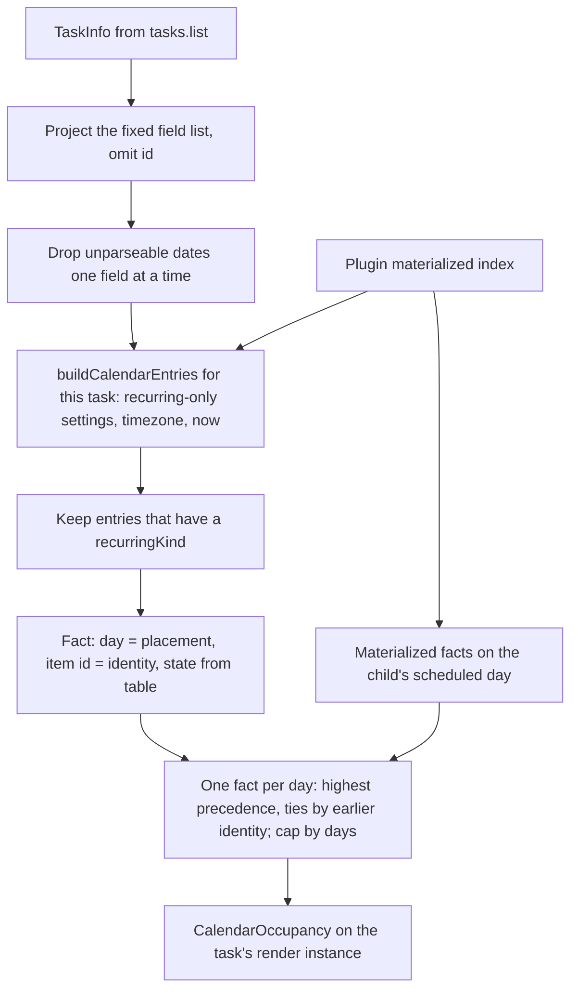
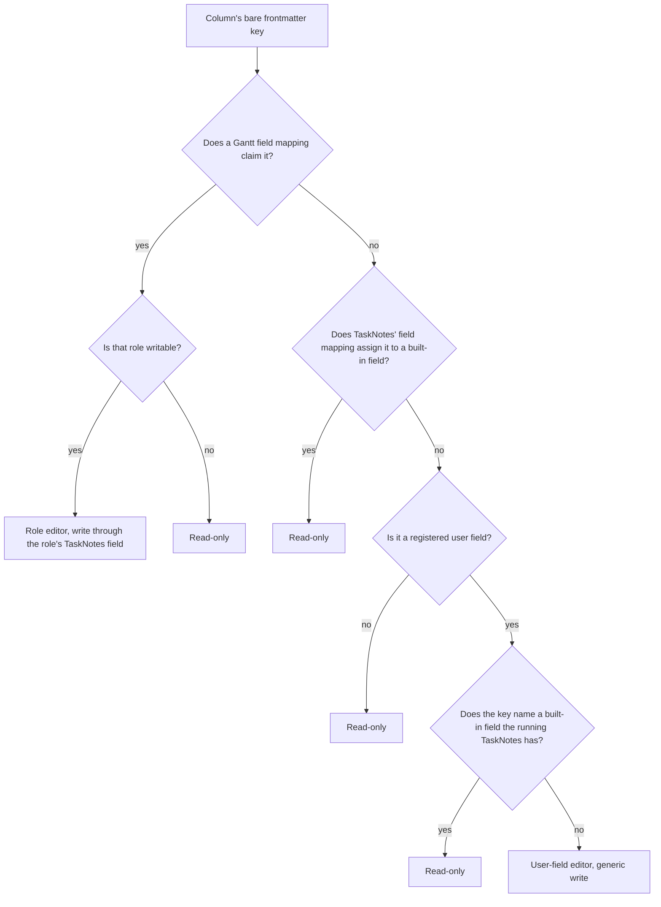
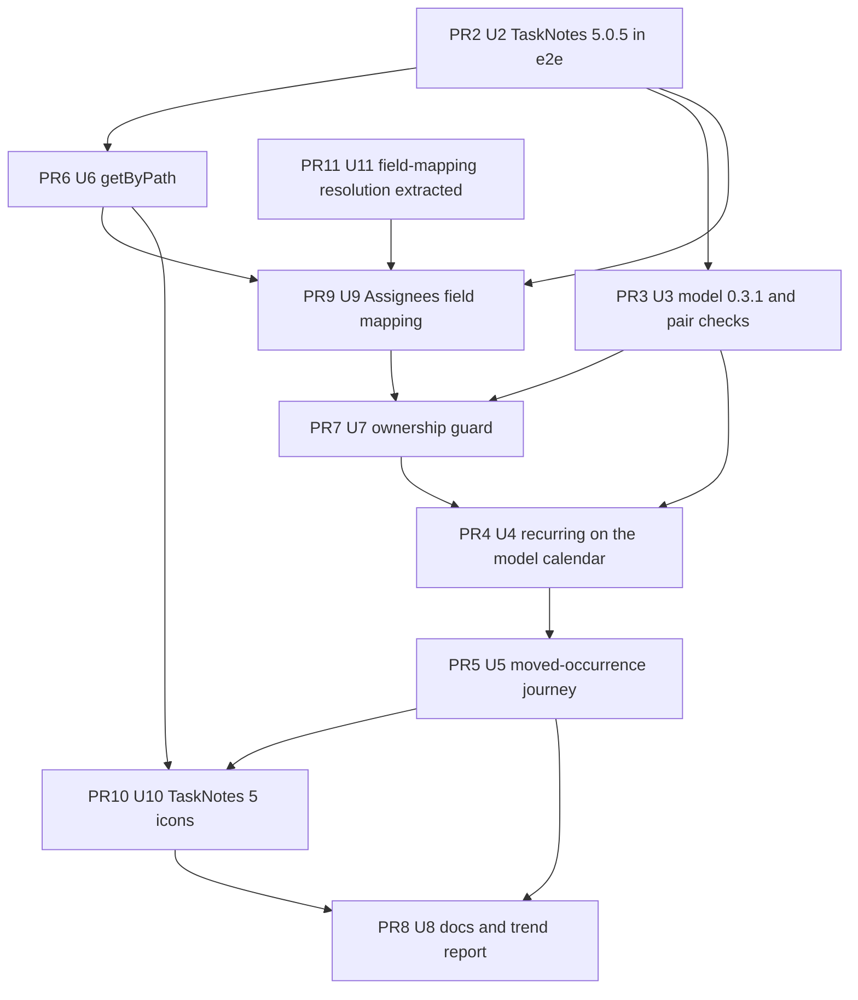

# Keep up with TaskNotes 5.0.5 - Plan

## Goal Capsule

- **Objective:** A user on stock TaskNotes 5.0.5 sees the same recurring-task days in the Gantt as in their TaskNotes calendar and the same status and priority icons as in TaskNotes' task list, and every Gantt read and edit keeps working, assignee lists included, with the end-to-end suite proving it against 5.0.5. Two edit behaviours change on purpose: a grid column on a TaskNotes-owned field that no Gantt field mapping claims becomes read-only (R9), and a date edit on a recurring task is recorded the way TaskNotes records it (R10).
- **Means:** Pin the e2e suite and the bundled `@tasknotes/model` to TaskNotes 5.0.5's versions (KTD1, KTD2), derive recurring occurrences from the model calendar TaskNotes draws with (KTD3), find TaskNotes-owned fields through TaskNotes' own field mapping (KTD10), and add Assignees as a Gantt field mapping (KTD14).
- **Authority:** This plan, then `AGENTS.md`, then `docs/engineering/practices.md`. On any question about TaskNotes behaviour, TaskNotes source at tag `5.0.5` and the `@tasknotes/model` 0.3.1 it ships decide.
- **Execution profile:** Ten PRs, one per unit, merged on green in this order: PR2, PR6, PR3, PR11, PR9, PR7, PR4, PR5, PR10, PR8 (AGENTS.md landing cadence). There is no PR1. The write-safety PRs land before the recurring PRs because they close data-loss paths: PR6 stops a failed lookup from overwriting dependency edges, and PR7 stops generic writes to fields TaskNotes 5 owns. PR7 waits for PR9, so the Assignees field mapping exists before the ownership guard could turn an assignee column read-only. A session ends at its first merged PR.
- **Stop conditions:** Stop the unit and hand over when a 5.0.5 e2e failure traces to a plugin defect outside the unit (fix it in its own PR first), when the model's fixtures show TaskNotes behaviour no KTD covers, or when a change would touch a ranked-defect file other than as the Ranked-file statement argues.
- **Who finishes:** Agent sessions through `ce-work`, one unit each; the maintainer intervenes by exception.

---

## Product Contract

### Summary

The plugin moves its verified TaskNotes baseline from 4.11.0 to stock 5.0.5. The e2e suite installs 5.0.5 and the plugin bundles the model library 5.0.5 ships. Recurring tasks are expanded by the same model calendar function the TaskNotes calendar uses, which brings v5's moved occurrences. Lookups move off the deprecated `tasks.get`, and generic property edits stop writing to fields TaskNotes 5 owns. A new Assignees field mapping keeps assignee lists editable through TaskNotes' own Assignees field, and the Gantt draws status and priority icons the way TaskNotes 5's task list does.

### Problem Frame

TaskNotes is the Gantt's system of record, and the Gantt has only been tested against TaskNotes 4.11.0 (`test/wdio/wdio.conf.mts`, `test/wdio/wdio.perf.conf.mts`). TaskNotes 5.0.5 is current and already runs in the maintainer's vaults. Render checks on 2026-11-25 and 2026-11-26 found no break, but they exercised nothing beyond rendering.

Recurring tasks are where the two diverge. `src/datasource/calendarItems/recurringSource.ts` claims parity "by construction" with the TaskNotes calendar by re-running the 4.11 calendar's read path over `@tasknotes/model` 0.2.1. TaskNotes has drawn its calendar with the model's own calendar function since 4.15.0 (TaskNotes commit `1d409727`), so the claim is stale.

Since 4.15.0 (TaskNotes commit `87677f11`), TaskNotes records a rescheduled next occurrence as a moved occurrence. `scheduled` holds the new day, `recurrence_original_date` holds the rule date, and the occurrence shows once, on the new day. `TaskService.updateTask` applies this to any `scheduled` change on a recurring task, so a date edit in the Gantt creates one. The Gantt does not read the property, so for users on TaskNotes 4.15 and later it likely draws such a task on both days today.

Two write-path gaps arrive with v5. `CANONICAL_TASKINFO_KEYS` in `src/controller/propertyPatchResolution.ts` is a hand-kept list that misses `attachments`, `assignees` and `recurrence_original_date`. It also compares a column's frontmatter key with TaskNotes' internal field names, so a field the user mapped to another property escapes it. 5.0.5 deletes an `attachments` value that is not a list (`src/services/task-service/taskUpdatePlanning.ts:483-485` at tag 5.0.5). And `tasks.get`, called at four sites, is deprecated.

TaskNotes 5 also turned a common user field into a built-in one. In 4.x, assignees were a registered list user field, which the Gantt grid edits. 5.0 adds a built-in Assignees field with its own property mapping (`FieldMapping.assignees` in `src/types.ts` at tag 5.0.5; no such field at 4.11.0). The maintainer points it at the old `assignee` property, and that column must stay editable, saved through TaskNotes' field rather than around it.

Finally, TaskNotes 5 redrew its status and priority icons (`src/ui/kit/glyphs.ts` at tag 5.0.5). A status without a configured icon shows a ring that fills as the status moves through the workflow, a check when completed and a cross when skipped. Priorities show dots ranked by weight. The Gantt's bar icon and legend still draw 4.x's hollow ring, filled disc and single dot (`src/bases/BarContent.svelte`, `src/bases/GanttLegend.svelte`), and its grid draws no icon at all.

### Requirements

**Verified against TaskNotes 5.0.5**

- R1. The functional and perf e2e suites install stock TaskNotes 5.0.5 from one pin, and the functional run fails when the pinned TaskNotes has no readiness member, so a green run is evidence.
- R2. The plugin bundles exactly the `@tasknotes/model` version TaskNotes 5.0.5 ships, and a check fails when the tested TaskNotes and the bundled model stop matching.

**Recurring tasks match the TaskNotes calendar**

- R3. For a recurring task, the Gantt shows the same occurrence days and states as the TaskNotes 5.0.5 calendar under the same three toggles: show recurring, show completed, show skipped.
- R4. A moved occurrence shows once, on the day it was moved to, and its original rule date stays its identity for completed and skipped state. Google-calendar moved dates suppress their original days the same way.
- R5. When two occurrences of one task fall on the same day, the day shows the higher-precedence state.
- R6. A materialized occurrence's marker on the parent row sits on the day its note is scheduled, falling back to its `occurrence_date`.
- R7. An unparseable date drops only that date, as in TaskNotes; the rest of the task still renders.

**Writes stay safe on TaskNotes 5**

- R8. Task lookups use `tasks.getByPath` when TaskNotes offers it and `tasks.get` otherwise. A dependency write whose lookup finds no task writes nothing.
- R9. A generic property edit never writes to a field TaskNotes treats as its own, identified by the property TaskNotes' field mapping assigns that field. Such a column is edited only through a Gantt field mapping that claims it, and the cell editor offers no editor where the write path would refuse.
- R10. Editing a recurring task's dates in the Gantt passes the new `scheduled` to `tasks.update` unchanged; TaskNotes decides what the move means.

**Assignee lists stay editable**

- R13. A view's Assignees field mapping (`tngantt_assigneesProperty`), left unset on TaskNotes 5, resolves to TaskNotes' Assignees property. Its column edits as a multi-value list and saves through TaskNotes' `assignees` field.
- R14. On TaskNotes 4, which has no Assignees field, an assignee column backed by a registered TaskNotes user field stays editable as it is today.

**Icons match TaskNotes 5**

- R15. On TaskNotes 5, the bar's status or priority icon and the legend draw each configured status and priority the way TaskNotes 5's task list does; on TaskNotes 4 they keep today's ring, disc and dot.
- R16. On TaskNotes 5, the grid's mapped status and priority columns show the same icon before each value.

**Compatibility statement**

- R11. Users on TaskNotes 4.11 through 4.x keep a working Gantt for reading, editing and dependencies. Recurring placement follows 5.0.5 rules, and the docs say it may differ from their 4.x calendar.
- R12. The docs name 5.0.5 as the verified TaskNotes version, and source comments in the files this plan edits carry no TaskNotes version stamps.

### Key Decisions

- **Target stock TaskNotes 5.0.5.** (session-settled: user-approved — chosen over the maintainer's fork build, `renatomen/tasknotes` branch `dogfood`: stock is what other users install, and CI cannot reach a build that exists on one machine.) Governs R1, R2, R3.
- **5.0.5 is the parity baseline; 4.x keeps working, but its recurring placement may differ.** (session-settled: user-approved — chosen over keeping the bundled model at the version the minimum supported TaskNotes ships: that rule holds the Gantt on pre-4.15 calendar semantics.) This plan supersedes that rule, stated in `docs/plans/2026-08-03-001-feat-calendar-view-union-plan.md` in its model-pin decision and U4 step 4. Governs R2, R11, R12.
- **The version check runs in tests, not in the product.** (session-settled: user-approved — chosen over an in-product warning: a 4.x user would see it every session with nothing to act on.) Governs R2.
- **TaskNotes decides what a date edit on a recurring task means.** TaskNotes is the system of record and every write goes through its API (STRATEGY.md § Our approach), so the Gantt neither re-interprets nor overrides it. Governs R10.
- **A materialized marker follows its note's placement.** The TaskNotes calendar draws a materialized occurrence on its note's `scheduled` day and a moved virtual occurrence on its moved day; the Gantt follows both. Governs R6.
- **`minAppVersion` stays 1.10.0.** (session-settled: user-approved — chosen over raising it to TaskNotes 5's 1.13.1: the plugin also works without TaskNotes.) Governs R11.
- **Assignees becomes a Gantt field mapping, built like Status.** (session-settled: user-directed — chosen over leaving TaskNotes-owned assignee columns read-only: the maintainer ruled read-only "unacceptable — a key usability feature".) Governs R9, R13, R14.
- **The Gantt follows TaskNotes 5's icon rule.** (session-settled: user-directed — chosen over keeping 4.x's ring and disc: the Gantt should look like the task list users see beside it.) Governs R15, R16.

### Success Criteria

- The functional and perf e2e suites pass against stock TaskNotes 5.0.5, locally and in CI.
- Every scenario with recurring entries in the model's shipped calendar fixtures (`@tasknotes/model/calendar/fixtures`: 34 scenarios and 11 moved-occurrence fixtures) yields, through the Gantt's adapter, the occupancy days and states its expected entries imply.
- The reading, inline-editing and dependency specs pass in one local run against TaskNotes 4.11.0 on the plan's final code, recorded in the U8 PR (R11, R14).
- The U3 PR states how much `main.js` grew with the model bump.

### Scope Boundaries

- Out: the fork's dependency fields (relationship-typed blocking, status categories, per-endpoint blocking). Anything that might use them stays optional.
- Out: switching task identity from file path to v5's `TaskInfo.id`.
- Out: detecting new TaskNotes releases automatically.
- Out: matching TaskNotes' Agenda and completion calendar, which still call `generateRecurringInstances` directly in 5.0.5.
- Considered, not built: an in-product version-mismatch warning (Key Decisions). Users confused by 4.x recurring differences would change this.
- Considered, not built: a separate visual state, or "moved from" hover text, for moved occurrences. The TaskNotes calendar shows a moved occurrence as an ordinary next occurrence, and parity argues for the same.
- Considered, not built: `createCalendarEntryIndex` caching (KTD3). A slow U4 timing on multi-year windows would change this.
- Considered, not built: Gantt field mappings for `attachments` and the other TaskNotes-owned fields beyond Assignees. Their columns are read-only (R9). A user asking to edit one in the grid would change this.
- Considered, not built: an icon for a task whose status or priority is empty or names nothing TaskNotes has configured. TaskNotes 5 draws a dashed ring or a help icon there; the Gantt keeps drawing no icon, as today. Such a value has no palette entry to carry its state (KTD17), and a TaskNotes-version flag on the render contract would touch `src/bases/types/gantt-view-data.ts` (rank 10). A user missing those icons would change this.

#### Deferred to Follow-Up Work

- Under TaskNotes 4.15 and later, a dependency cascade or subtree shift that moves a recurring successor creates a moved occurrence on it; shipped releases already do this. Whether the Gantt should skip or confirm such successors is a product question; U8 records it in the backlog.
- TaskNotes does not export its icon rule, so the Gantt copies it (KTD17). A companion glyph API offered upstream through the maintainer's fork would let the Gantt call TaskNotes' rule instead; U8 records it in the backlog.

### Sources

- TaskNotes at tag `5.0.5` (fork checkout `../tasknotes`, machine-local):
  - `src/bases/calendarModelEvents.ts`: projection field list, `withValidDates`, materialized map.
  - `src/bases/CalendarView.ts`: timezone, clock and toggle context.
  - `src/services/task-service/recurringMoveIdentity.ts` and `src/services/TaskService.ts:694`: moved-occurrence capture on update.
  - `docs/features/recurring-tasks.md` § Rescheduling a virtual occurrence.
  - `src/api/TaskNotesAPI.ts:733`: `model.info()` reports `specVersion` only.
  - `src/api/TaskNotesAPI.ts` `CORE_FIELD_DEFINITIONS` and `getFieldDefinitions`: `catalog.fields()` resolves each core field's `frontmatterKey`, but its core list has no `assignees` or `recurrence_original_date`.
  - `src/types.ts` `FieldMapping`: `assignees`, `attachments`, `recurrenceOriginalDate`.
  - `src/services/task-service/taskUpdatePlanning.ts` `applyTaskUpdateFrontmatterChange`: how `tasks.update` maps built-in fields and writes user fields.
  - `src/ui/kit/glyphs.ts` (`statusGlyphState`, `renderStatusGlyph`, `priorityGlyphState`, `renderPriorityGlyph`) and `src/ui/taskCardPrimaryIndicators.ts` (`configureStatusIndicator`, `configurePriorityIndicator`: a configured icon wins).
  - `src/settings/defaults.ts:376`: `enableMdbaseSpec: true`.
- Tags `5.0.0` through `5.0.5` carry `tasks.getByPath` and `src/ui/kit/glyphs.ts`; tags `4.18.1` through `4.18.4` carry neither.
- `@tasknotes/model` 0.3.1: README § Calendar contract, `dist/types/calendar.d.ts`, `dist/esm/calendar.js` (`buildTaskEntries`, `buildCalendarEntries`), and its `mapping.js`, which writes `assignees` to the mapped frontmatter key as a list.
- `docs/reports/2026-08-15-001-maintainability-rediagnosis.md`, ranked entries 2 and 4, and `maintainability-registry.json`.
- Learnings to read before the matching unit:
  - U2: `docs/solutions/developer-experience/gate-e2e-on-cold-index-before-measuring-render.md`, `docs/solutions/integration-issues/starter-note-steals-active-leaf-e2e-flake.md`, `docs/solutions/developer-experience/wdio-runtime-behavior-needs-a-real-run.md`.
  - U4: `docs/solutions/best-practices/assert-the-claim-not-the-mechanism.md`, `docs/solutions/architecture-patterns/a-guard-that-restates-its-subject-names-a-missing-seam.md`, `docs/solutions/logic-errors/all-day-event-boundaries-floating-not-instant.md`.
  - U6, U10: `docs/solutions/integration-issues/tasknotes-status-palette-wrong-api-path.md`.
  - U6, U7, U9: `docs/solutions/integration-issues/tasknotes-custom-field-write-top-level-key.md`.
  - U3, U7, U9: `docs/solutions/best-practices/derive-the-member-list-from-keyof-not-a-runtime-probe.md`, `docs/solutions/workflow-issues/state-the-rule-derive-the-list.md`, `docs/solutions/best-practices/a-test-name-is-a-claim-verify-the-mutation.md`.
  - U11: `docs/solutions/best-practices/brand-the-producers-return-type-not-the-shared-domain-type.md`.
- Research dossiers with line references (machine-local, best effort; a missing dossier does not block): `C:\Users\renat\AppData\Local\Temp\compound-engineering-197609\ce-plan-research\ca574a7a\` — `api-diff.md`, `framework-docs.md`, `repo-research.md`, `learnings.md`, `spec-flow.md`.
- The handoffs that started this work (untracked): `docs/handoffs/2026-11-25-tasknotes-v5-compatibility-handoff.md`, `docs/handoffs/2026-11-26-tasknotes-5.0.5-update-handoff.md`.

---

## Planning Contract

### Key Technical Decisions

- KTD1. **Bundle `@tasknotes/model` at exactly 0.3.1.** That is TaskNotes 5.0.5's pin, and parity means running the code TaskNotes runs; 0.3.2's contents are unverified. Governs R2.
- KTD2. **One committed pin file pairs the TaskNotes version with its model version, and two checks hold the pair.** (session-settled: user-approved — chosen over a runtime check in the product, per Key Decisions.) Both WDIO configs read the file with `fs`; neither imports an `.mts` module, because `wdio.perf.conf.mts`'s header records loader fragility there. A jest test asserts that `package.json`'s exact `@tasknotes/model` dependency equals the pin. An e2e assertion compares TaskNotes' `api.model.info().specVersion` with the bundled `TASKNOTES_SPEC_VERSION` (`"0.3.0-rc.6"` in 0.3.1). The spec string alone cannot catch a wrong pin: models 0.3.0 and 0.3.1 both report `"0.3.0-rc.6"`, and `model.info()` reports no package version. So the e2e setup also reads `@tasknotes/model` from TaskNotes' own `package.json` at the pinned tag on GitHub, where the configs already download TaskNotes from, and fails when it differs from the pin's model version. Governs R2.
- KTD3. **Derive recurring occurrences with `buildCalendarEntries`, called once per task.** It is the core the TaskNotes calendar runs. `createCalendarEntryIndex` is rejected: it is a cache keyed on object identity, which the plugin's pure derivation does not need. Rebuilding from `generateRecurringInstances` is rejected: it would re-implement the identity, moved-day and look-back logic inside the model's `buildTaskEntries`, which is the drift this plan removes. One call per task keeps a bad task from failing the batch. Settings pass the three recurring toggles through and turn every other output off (`showScheduled`, `showDue`, `showTimeEntries`, `showScheduledToDueSpan`, `showOverdueOnToday`), and only entries with a `recurringKind` are kept. Governs R3, R4.
- KTD4. **Mirror TaskNotes 5.0.5's host adapter, not only the model call.** The model throws on any invalid date. TaskNotes' `calendarModelEvents.ts` projects a fixed field list and drops unparseable dates one field or list item at a time (`withValidDates`, which also accepts `YYYY-MM-DD HH:mm`). The plugin mirrors both and omits `id` from the projection, so the model's task id is the path. It keeps its own `isRealCalendarDay` guard on `scheduled`. The `TaskNotesTaskInfo` slice in `src/datasource/TaskNotesSource.ts` widens to the fields the projection forwards, including `recurrence_original_date`, `googleCalendarMovedOriginalDates` and `googleCalendarExceptionOriginalScheduled`. Governs R3, R7.
- KTD5. **An occupancy fact's `day` is the placement; its identity rides in the item id.** Placement is the local civil day of `entry.start` in the context timezone, found with the exported `calendarDateToInstant` and `calendarInstantToDate`. Identity is `entry.instanceDate`, used as the `makeCalendarItemId` qualifier. `CalendarOccupancy` keeps its shape, so `GanttController.occupancyEqual` needs no change. Governs R4.
- KTD6. **Each placement day keeps one fact, the highest-precedence one.** The renderer keeps one piece per day (`src/render/segmentLayout.ts`: "later runs win each day"), and the item id is read only by change detection, so a second fact on the same day would never reach the screen. Among the entries placed on one day, the fact ranked highest in the state table below wins, ties broken by the earlier identity. Precedence ranks how concrete a fact is: a recorded completion or skip is something the user did, a materialized note is a real file, a next occurrence is a pending commitment, and a projection is a guess. Completed ranks above skipped, as in the current engine's recorded-state check. The per-series cap `MAX_OCCUPANCY_DAYS_PER_SERIES` counts days and keeps the latest, as the current engine does (`slice(-MAX_OCCUPANCY_DAYS_PER_SERIES)`). (session-settled: user-approved — chosen over emitting every same-day fact in a total order with a fact-count cap: the extra facts never reach the screen.) Governs R5.
- KTD7. **The plugin keeps its own materialized index and uses it twice.** The model has no materialized entry kind; it only suppresses those days on the parent. The plugin's index feeds the model as `materializedOccurrences`, keyed by parent path. It also emits the `materialized` facts, placed on the child's valid `scheduled` day, else on `occurrence_date`, with `occurrence_date` as identity. Governs R6.
- KTD8. **Timezone and clock are injected, with defaults inside the recurring module.** The defaults mirror TaskNotes: the resolved `Intl` time zone, else `"UTC"`, and the current time. They are not threaded through `src/bases/register.ts`, which is ranked 2. Governs R3.
- KTD9. **One lookup resolver picks `getByPath` by its presence, not by its result.** `tasks.getByPath` is used when it is a function, else `tasks.get`; a v5 not-found never falls back to the deprecated `get`. `TaskNotesSource` and `taskNotesInteractions` share the resolver. `readBlockedBy` refuses a `null` lookup instead of reading it as "no edges", which would overwrite the stored edges. Governs R8.
- KTD10. **TaskNotes-owned fields are found through the running TaskNotes' field mapping, and a Gantt field mapping always wins.** A column is owned when its bare key is a property that `model.config().fieldMapping`, the map the Gantt already reads for its date and status defaults, assigns to a built-in field. `catalog.fields()` cannot serve: at tag 5.0.5 it lists neither `assignees` nor `recurrence_original_date` as a core field. Mapped roles are matched first, as today. An owned column that no role claims is read-only, so `attachments` and `recurrence_original_date` stay read-only. A second check guards the update object, not the column. A generic write sends its key at the top level of `tasks.update`, which reads a key named like one of the running TaskNotes' built-in fields as that field, so such a key is refused. Its members are the keys of the bundled model's update type that the running TaskNotes also has. The update type side is a `Record<keyof TaskUpdateInput, true>`, so a model bump that adds a field fails typecheck until the set covers it. The running-TaskNotes side keeps a TaskNotes 4 user field named `assignees` writable, because 4.x has no Assignees field (R14). `DEFAULT_FIELD_MAPPING` is rejected as a source: it lacks `details` and `tags`, so deriving from it would let an edit overwrite the note body (refusal pinned in `test/unit/propertyPatchResolution.test.ts`). When the field mapping cannot be read, ownership is unknown and the guard fails closed: a column no role claims gets no editor and its generic write is refused. Every supported TaskNotes reports its field mapping, so only a degraded API reaches this path, and guessing there would let a renamed built-in property be written as a plain one. One exported resolution feeds both `resolvePropertyPatch` and `src/bases/cellEditability.ts`. Governs R9, R14.
- KTD11. **The e2e suite runs one TaskNotes configuration: fresh-install defaults.** TaskNotes 5.0.5 turns `enableMdbaseSpec` on for fresh installs, and every e2e run installs fresh into a temporary vault copy. Testing what new users get wins. A fixture Base that then lists mdbase's generated `.md` files gets a tighter filter, and the spec that seeds a TaskNotes `data.json` declares the same setting explicitly. Governs R1.
- KTD12. **Parity is proven with TaskNotes' own fixtures, not by comparing the adapter with the model.** Each fixture's inputs go through the adapter's whole path, projection and date validation included, and its output is compared with the occupancy the fixture's `expectedEntries` imply. Before comparison, expected recurring entries reduce to one fact per task and `instanceDate`, placed on the earliest start day among that identity's entries, then to one fact per day under KTD6. The extra per-day entries in the span-enabled fixtures `recurring-timed-spans-keep-occurrence-identities` and `native-moved-timed-span-segment-identities` are TaskNotes' span display, which KTD3 turns off. Gantt-only behaviour (KTD6, KTD7, the cap, invalid dates) gets hand-written oracle cases. A test comparing the adapter with `buildCalendarEntries` would restate its subject. Governs R3, R4, R5, R6, R7.
- KTD13. **Comment version stamps are dropped after each claim is re-checked against 5.0.5.** AGENTS.md forbids volatile references in comments, and a re-checked claim stands without a version. Governs R12.
- KTD14. **Assignees is a mapped role built exactly like Status.** It joins `FieldMappings`, `MappedFieldRole` and `ROLE_PROPERTY`, `FIELD_MAPPING_KEYS` (`tngantt_assigneesProperty`), the view options, and the resolution step U11 extracts, which resolves it with `resolveMappedProperty` against TaskNotes' Assignees property (`fieldMapping.assignees` from `model.config()`) and gates it with `writesToSameProperty`. A write sends `{ assignees: [...] }` through `tasks.update`, and model 0.3.1 writes that list to the mapped frontmatter key. The editor is the existing `list` kind. When TaskNotes reports no Assignees mapping, as on TaskNotes 4, the role claims no column even if the view names one, so a registered `assignee` user field keeps today's editor and generic write. Nothing draws assignees, so `src/bases/entrySignature.ts` (rank 8) does not watch the role. Both role-precedence lists, `EDITOR_ROLE_PRECEDENCE` and `PATCH_ROLE_PRECEDENCE`, become compile-time complete over `MappedFieldRole`, so this role and any later one cannot be left unmatched (`CONCEPTS.md` § Derived member list). (session-settled: user-directed — chosen over leaving TaskNotes-owned assignee columns read-only: the maintainer ruled read-only unacceptable.) Governs R13, R14.
- KTD15. **TaskNotes' readiness member is asserted once, in the version spec.** U2's version spec asserts that the loaded TaskNotes' `api.lifecycle.ready` is a function; the per-spec waits stay as they are, and they already time out when TaskNotes is absent. (session-settled: user-approved — chosen over a shared readiness helper rewritten into 14 specs: 5.0.5 ships the member, and one assertion against the pinned version covers it.) Governs R1.
- KTD16. **Field-mapping resolution moves out of `GanttController` before Assignees joins it, and its writability becomes one record keyed by role.** Rank 4's entry in `docs/reports/2026-08-15-001-maintainability-rediagnosis.md` names this block (`applyFieldMappingDefaults` with `resolveMappedProperty` and `writesToSameProperty`) as the controller's clearest first slice. A pure module takes the view's mappings and TaskNotes' field config and returns the effective mappings, the date write targets, the date-mapping info and a branded writability record. The controller stores the result, `src/bases/register.ts` passes the record where it passes `isStatusWritable()` and `isPriorityWritable()` today, and the render contract and the write path read it. A writable role added later then touches neither ranked file. Rejected: an `isAssigneesWritable()` accessor beside the other two, which grows both ranked files for this role and every later one. Governs R13.
- KTD17. **The Gantt reproduces TaskNotes 5.0.5's icon rule and carries each icon's state on its palette entry.** TaskNotes exports neither the state rule nor its renderers, so a dependency-free module reproduces `statusGlyphState` and `priorityGlyphState`, with tests pinning each case against that source. A configured icon still wins, as on TaskNotes' task card and in the Gantt today. `TaskNotesSource` adds each status and priority palette entry's state, computed from `catalog.statuses()` and `catalog.priorities()`, only on TaskNotes 5. The version test is `tasks.getByPath` being a function, the predicate U6's resolver owns (principle 4): `getByPath` and the icon kit both arrive in 5.0.0 (Sources). The view draws an entry's state when it has one, else today's ring, disc or dot. The palettes already reach the bar chip, the legend and the grid's cell descriptors through the controller and `register.ts` unchanged, so no ranked file is touched. (session-settled: user-directed — chosen over keeping 4.x's ring and disc: the Gantt should look like the task list users see beside it.) Governs R15, R16.

### High-Level Technical Design

Recurring derivation after U4:

Model entry to occupancy state, lowest precedence first (KTD6):

| Source | Occupancy state | Precedence |
|---|---|---|
| `recurringKind: pattern`, neither flag set | `projected` | 1 |
| `recurringKind: next-scheduled`, neither flag set | `next` | 2 |
| Plugin materialized index | `materialized` | 3 |
| Any kind with `isSkipped` and not `isCompleted` | `skipped` | 4 |
| Any kind with `isCompleted` | `completed` | 5 |

How a grid column's edit resolves after U7 and U9 (KTD10, KTD14). The cell editor and the write path take the same branches:

PR order (each arrow is a `Waits on:` line below):

### Ranked-file statement

The ranked list is `maintainability-registry.json`, argued in `docs/reports/2026-08-15-001-maintainability-rediagnosis.md`. One unit touches ranked files, and only to shrink them:

- U11 touches `src/controller/GanttController.ts` (rank 4: "Clearest first slice: the ~80-line mapping-resolution block inside `selectSource`") and `src/bases/register.ts` (rank 2: "The junction box every view-level feature passes through"). It takes rank 4's named first slice (KTD16). In `register.ts` the two writability arguments become one. The improvement claim is behavioural: the resolution rules are tested without a controller, and a new writable role touches neither file. The PR states each file's line and concern deltas from the trend measurement's output; the `register.ts` change is a relocation with no concern delta, and the PR annotates it so. U11 also drops the version stamp in the `extractCorrelationId` comment after re-checking its claim (KTD13).
- No other unit touches a ranked file. KTD5 keeps the occupancy shape, KTD8 keeps the recurring seams out of `register.ts`, KTD14 keeps Assignees out of `src/bases/entrySignature.ts` (rank 8), and KTD17 keeps the icon state off `src/bases/types/gantt-view-data.ts` (rank 10) and `src/bases/GanttContainer.svelte` (rank 1). `test/specs/gantt-calendar-editor.e2e.ts` (rank 6) is not edited.

Review contract for every PR of this plan (AGENTS.md § Review guidelines, ranked-defect files; `docs/engineering/practices.md` § Charter-owned practice items):

- Invariant: no PR moves a diagnostics or instrumentation concern into a ranked file except through its seam module, and a PR that grows a ranked file's line or concern count states why, read against the trend measurement's output.
- Placement rule: instrumentation and diagnostics live in their own module behind a seam; junction files keep only the call hooks, and the lifecycle-capture names of `src/debugLog.ts` are imported only by the seam. U11 adds neither.

If any other ranked-file change turns out to be needed, the unit stops (Goal Capsule) and the change gets its own plan citation.

### Deferred to Implementation

- Names and locations of the pin file, the host-adapter module, the exported canonical-key set, the extracted field-mapping resolution module with its writability record, and the icon-state module.
- Which `test/unit/recurringSource.test.ts` assertions turn red under U4, and whether each is a claim to keep or a 4.11 mechanism to rewrite (U4 execution note).
- Whether any Base under `test/vaults/` lists mdbase's generated files once 5.0.5 runs (U2).
- Whether the model throws on a malformed `googleCalendarMovedOriginalDates` or `googleCalendarExceptionOriginalScheduled` entry, which decides whether the `withValidDates` mirror must cover them (U4).
- What 5.0.5 writes for `{ assignees: [] }`, an empty list or no property; U9's e2e asserts the observed value (U9).
- Whether `tasks.update` passes `customFrontmatter` through at 4.11.0 and 5.0.5. If it does, a user field whose key names a TaskInfo field could be written by its frontmatter key, and KTD10's internal-name check could narrow (U7).
- How the grid's cell descriptor carries the icon state into `src/bases/PropertyCell.svelte` (U10).
- How U7 reads the running TaskNotes' built-in field names for KTD10's update-key check: `catalog.fields()` core ids, the field mapping's keys, or both. Their spellings differ (`recurrenceOriginalDate` in the mapping, `recurrence_original_date` in the update type). U7's tests pin `assignees` on a 4.11.0 and a 5.0.5 field config either way.
- Whether `model.config().fieldMapping` carries optional entries such as `recurrenceOriginalDate` when the user's settings omit them, or whether U7 must apply TaskNotes' documented default (U7).

---

## Implementation Units

### PR2: TaskNotes 5.0.5 in the e2e suite

Waits on: nothing.

### U2. Install stock TaskNotes 5.0.5 in both suites from one pin

- **Goal:** The functional and perf e2e suites install stock TaskNotes 5.0.5 from one pin and pass against it, and a run against a TaskNotes without its readiness member fails.
- **Requirements:** R1.
- **Dependencies:** None.
- **Files:**
  - A new pin file under `test/wdio/`. U2 creates it; U3 extends it.
  - `test/wdio/wdio.conf.mts`, `test/wdio/wdio.perf.conf.mts`.
  - `test/specs/gantt-calendar-items-external.e2e.ts`, which seeds a TaskNotes `data.json` (KTD11).
  - A new spec that asserts the loaded TaskNotes version and readiness member, for example `test/specs/gantt-tasknotes-version.e2e.ts`; U3 extends it.
  - Only if a run shows the need: Bases under `test/vaults/` that list mdbase's files, and specs that read raw note text after a write.
- **Approach:**
  1. Both configs read the TaskNotes version from the pin file (KTD2), and `wdio.perf.conf.mts`'s header stops naming 4.11.0.
  2. The version spec asserts the loaded version and the readiness member (KTD15).
  3. Run both suites on 5.0.5 under fresh-install defaults (KTD11).
  4. Diagnose each red. A test assumption that 5.0.5 changed, such as raw note text after a patch-only `tasks.update` or mdbase files in a loose Base filter, is fixed here. A plugin defect is fixed in its own PR before this one merges (Goal Capsule).
- **Execution note:** Only the 4.11.0 download is cached locally, so the first 5.0.5 run downloads through the TLS-inspection proxy; CI downloads afresh on every run.
- **Patterns to follow:** The existing `{ repo, version }` plugin entry in both configs; the perf config header's reason for not importing the base config.
- **Test scenarios:**
  - One spec asserts that `manifest.version` of the loaded TaskNotes equals the pin's TaskNotes version, so the pin is shown to be in effect.
  - The same spec asserts that `api.lifecycle.ready` is a function on the loaded TaskNotes. With the assertion pointed at a member name TaskNotes lacks, for one local run reverted by inverse edit, it fails and names the member.
  - The existing suites are otherwise this unit's tests.
- **Verification:** Both suites green on 5.0.5 locally and in CI, the version and readiness assertions included; the readiness mutation run red with the member named; no change under `src/`.

### PR6: `getByPath` with a fallback

Waits on: PR2, needed before this group can start: its proof is the e2e suite running 5.0.5.

### U6. Look tasks up with `getByPath` where TaskNotes has it

- **Goal:** The plugin stops calling the deprecated `tasks.get` on TaskNotes 5, keeps working on TaskNotes 4.x, and a failed lookup no longer overwrites dependency edges.
- **Requirements:** R8, R12.
- **Dependencies:** U2.
- **Files:** `src/datasource/TaskNotesSource.ts`, `src/bases/taskNotesInteractions.ts`, and their unit tests under `test/unit/`.
- **Approach:**
  1. One resolver per KTD9 serves the four `TaskNotesSource` call sites and the edit-modal path in `taskNotesInteractions.ts`; the local API type gains an optional `getByPath`.
  2. The resolver's presence test is exported, so U10 reads the same predicate (KTD17).
  3. `readBlockedBy` refuses a `null` lookup, and the add and remove dependency paths surface that refusal as they surface other write failures.
  4. Re-check each "TaskNotes 4.11.0" comment in these two files against 5.0.5, correct any claim that no longer holds, and drop the stamps (KTD13).
- **Patterns to follow:** The existing `typeof tasks.update === 'function'` capability checks; the DI-mocked API objects in the existing tests.
- **Test scenarios:**
  - With `getByPath` and `get` both present, `getByPath` is called and `get` is not.
  - With only `get` present, as on TaskNotes 4.x, `get` is called.
  - With neither present, dependency writes refuse without calling `update`, and the edit-modal path falls back to opening the note.
  - When `getByPath` returns `null`, `get` is not called and add or remove dependency writes nothing.
  - Adding an edge to a `blockedBy` that already holds two writes all three, the existing two verbatim.
- **Verification:** Unit, typecheck and lint gates green; `test/specs/gantt-dependency-types.e2e.ts` and `test/specs/gantt-inline-edit.e2e.ts` green on 5.0.5; no direct `tasks.get` call remains outside the resolver.

### PR3: Model 0.3.1 and the version-pair checks

Waits on: PR2, needed before this group can start: U3 extends PR2's pin file, and its e2e assertion needs 5.0.5 in the suite.

### U3. Bundle `@tasknotes/model` 0.3.1 with checks that keep it paired with the tested TaskNotes

- **Goal:** The plugin ships the model TaskNotes 5.0.5 ships, and a unit check and an e2e check fail when the pair drifts.
- **Requirements:** R2.
- **Dependencies:** U2.
- **Files:** `package.json`, `package-lock.json`, the pin file from U2, `test/wdio/wdio.conf.mts` and `test/wdio/wdio.perf.conf.mts` (the setup check that reads TaskNotes' model version), a new jest test for the pair (for example `test/unit/tasknotesPin.test.ts`), the version spec from U2, `src/datasource/calendarItems/recurringSource.ts` (the TZID strip only), `test/unit/recurringSource.test.ts`, and a new `test/unit/recurringSource.timezone.test.ts` that U4 extends.
- **Approach:**
  1. Pin `@tasknotes/model` to exactly `0.3.1` (KTD1) and add the model version to the pin file (KTD2).
  2. Run the existing recurring characterization tests on this change alone. 0.3.1 parses single-line `DTSTART;VALUE=DATE:…;FREQ=…` and `DTSTART;TZID=…` rules that 0.2.1 silently misread as yearly; pin that with a test. Any other red is a regression to diagnose, never an assertion to loosen.
  3. Strip `;TZID=…` parameters from the rule before the engine calls `generateRecurringInstances`, as the model calendar does. Without it, 0.3.1 places every occurrence of a two-line TZID rule one day late in Los Angeles and Auckland until U4 lands.
  4. Measure `main.js` before and after, and state the growth in the PR.
- **Test scenarios:**
  - The pair test passes when `package.json` holds exactly the pin's model version, and fails when either side changes (proven once by mutation).
  - The pair test fails on a range such as `^0.3.1` in `package.json`.
  - A recurring task with the single-line rule `DTSTART;VALUE=DATE:<date>;FREQ=WEEKLY` expands weekly; under 0.2.1 it expanded yearly.
  - Timezone harness: a task with a two-line `DTSTART;TZID=…` and `RRULE:FREQ=WEEKLY` rule lands on the same days in Los Angeles, UTC and Auckland as it did under 0.2.1.
  - E2E: the running TaskNotes' `api.model.info().specVersion` equals the bundled `TASKNOTES_SPEC_VERSION`, and the check fails in one local run with the pin set to TaskNotes 4.11.0 (spec `0.2.0`), reverted by inverse edit.
  - E2E setup: with the pin's model version set to `0.3.0` for one local run, the setup check fails because TaskNotes 5.0.5's `package.json` requires `0.3.1`, though both report the same spec string; reverted by inverse edit.
- **Verification:** Unit, timezone, typecheck, lint and functional e2e gates green, locally and in CI; the `main.js` growth stated in the PR.

### PR11: Field-mapping resolution out of the controller

Waits on: nothing.

### U11. Extract field-mapping resolution from `GanttController`

- **Goal:** Field-mapping resolution lives in a pure, directly tested module, so a new mapped role is added without touching a ranked file, and no behaviour changes.
- **Requirements:** R12 (the comment stamp), and the seam R13 builds on.
- **Dependencies:** None.
- **Files:**
  - New: the resolution module beside the controller, for example `src/controller/fieldMappingResolution.ts`, and `test/unit/fieldMappingResolution.test.ts`.
  - `src/controller/GanttController.ts`: `applyFieldMappingDefaults`, `resolveMappedProperty`, `writesToSameProperty`, the two writability accessors and their brands, and the `extractCorrelationId` comment.
  - `src/bases/register.ts`: the writability arguments of the render-input assembly.
  - `src/bases/ganttRenderContract.ts`, `src/controller/propertyPatchResolution.ts` and `src/bases/cellEditability.ts`: their writability inputs.
  - `test/unit/GanttController.test.ts` and the tests of the files above.
- **Approach:**
  1. Move the resolution into one pure function per KTD16.
  2. The controller stores its result; `register.ts` passes the record in place of the two accessor values; the render contract and the write path read the record.
  3. Re-check the `extractCorrelationId` comment's claim against 5.0.5 and drop its version stamp (KTD13).
  4. State the ranked-file deltas and the improvement claim in the PR (Ranked-file statement).
- **Execution note:** Extract-and-test, never extract-and-move: pin today's resolution rules in the new module's tests before moving any code, and move the controller tests that exercise those rules instead of duplicating them. One commit per step.
- **Patterns to follow:** `src/controller/propertyPatchResolution.ts` and `src/controller/sortKeyMapping.ts`, earlier pure extractions from the controller; `docs/solutions/best-practices/brand-the-producers-return-type-not-the-shared-domain-type.md` for the record's brand.
- **Test scenarios:**
  - An unset Status mapping resolves to TaskNotes' status property and is writable; a view mapped to another property is read-only.
  - The same two cases for Priority.
  - Start and end resolve to the same write targets, read properties and invalid-mapping flags as today.
  - With no TaskNotes field config, the mappings pass through unchanged and no role is writable.
  - The writability record has one entry per writable role; a role added to the role type without an entry fails typecheck (proven once by mutation, reverted by inverse edit).
- **Verification:** Unit, typecheck and lint gates green; `test/specs/gantt-inline-edit.e2e.ts` and `test/specs/gantt-divergent-status-mapping.e2e.ts` green; both ranked files shorter, with the deltas in the PR.

### PR9: The Assignees field mapping

Waits on:
- PR11, needed before this group can start: the role joins the extracted resolution.
- PR2, needed before this group can start: its e2e needs TaskNotes 5.0.5's Assignees field.
- PR6, merge order only: both edit `src/datasource/TaskNotesSource.ts`.

### U9. Map an Assignees property and save it through TaskNotes' Assignees field

- **Goal:** On TaskNotes 5, an assignee column edits as a list and saves through TaskNotes' Assignees field; on TaskNotes 4, the registered user field keeps working as today.
- **Requirements:** R13, R14.
- **Dependencies:** U2, U11; merges after U6.
- **Files:**
  - `src/datasource/fieldMappings.ts`, `src/datasource/mappedFieldRole.ts`, `src/bases/fieldMappingConfig.ts`, `src/bases/viewOptions.ts`, and the module U11 created.
  - `src/datasource/types.ts` (the field config and `TaskPatch`) and `src/datasource/TaskNotesSource.ts` (`getFieldConfig` reads `fieldMapping.assignees`; the update builder writes `assignees`).
  - `src/controller/propertyPatchResolution.ts`, `src/bases/cellEditability.ts`.
  - Tests: `test/unit/mappedFieldRole.test.ts`, `test/unit/readFieldMappings.test.ts`, `test/unit/viewOptions.test.ts`, `test/unit/propertyPatchResolution.test.ts`, `test/unit/cellEditability.test.ts`, `test/unit/TaskNotesSource.test.ts`, U11's module test, and a new spec, for example `test/specs/gantt-assignees-edit.e2e.ts`.
- **Approach:**
  1. Add the role per KTD14 in each listed file.
  2. Make both role-precedence lists compile-time complete over `MappedFieldRole` (KTD14).
  3. The new spec maps TaskNotes' Assignees field to `assignee` at runtime by writing TaskNotes' settings, as `gantt-inline-edit.e2e.ts` registers its user fields.
- **Patterns to follow:** Status end to end: `statusProperty` in `fieldMappingConfig.ts` and `viewOptions.ts`, `statusProp` in `getFieldConfig`, and the status branch of `mappedFieldPatch`.
- **Test scenarios:**
  - With TaskNotes' Assignees mapped to `assignee` and the view option unset, the role resolves to `note.assignee`, the column gets a list editor, and an edit produces `{ assignees: [...] }`, not a generic write.
  - With the view option set to TaskNotes' own Assignees property, the result is the same; set to any other property, the column is read-only and an edit is refused, as for Status.
  - Wikilink entries such as `[[Alice]]` reach `tasks.update` unchanged.
  - With no Assignees mapping in TaskNotes' field config, as on TaskNotes 4, the role claims no column even when the view option names `assignee`, and a registered `assignee` list user field keeps its editor and generic write.
  - Removing a role from either precedence list fails typecheck (proven once by mutation, reverted by inverse edit).
  - The option is read from and persisted under `tngantt_assigneesProperty`.
  - E2E on 5.0.5: adding one entry and removing another in the assignee cell writes the new list to the note's `assignee` property and re-renders the cell.
  - E2E on 5.0.5: clearing every entry leaves the value 5.0.5 writes for `{ assignees: [] }` (Deferred to Implementation).
- **Verification:** Unit, typecheck and lint gates green; the new spec and `test/specs/gantt-inline-edit.e2e.ts` green on 5.0.5. R14's TaskNotes 4 path is proven by the unit scenarios above and by U8's 4.11.0 run of `gantt-inline-edit.e2e.ts`, which edits a registered `assignee` user field.

### PR7: The ownership guard through TaskNotes' field mapping

Waits on:
- PR3, needed before this group can start: the internal-name set derives from the 0.3.1 types.
- PR9, needed before this group can start: the guard's tests cover the Assignees role winning over it, and merging after PR9 keeps assignee columns editable on main.

### U7. Refuse generic writes to every field TaskNotes owns

- **Goal:** A property edit never writes around a TaskNotes-owned field, ownership comes from TaskNotes' field mapping, and the write guard and the cell editor read one resolution.
- **Requirements:** R9.
- **Dependencies:** U3, U9.
- **Files:** `src/controller/propertyPatchResolution.ts`, `src/bases/cellEditability.ts`, `src/datasource/TaskNotesSource.ts` (reads the whole field mapping), `src/datasource/types.ts` (the field config), and the module U11 created if ownership rides its output; tests `test/unit/propertyPatchResolution.test.ts`, `test/unit/cellEditability.test.ts`, `test/unit/TaskNotesSource.test.ts`.
- **Approach:**
  1. Read the owned properties from TaskNotes' field mapping per KTD10, failing closed when it cannot be read.
  2. Derive the update-key set from the update type, narrowed to the running TaskNotes' built-in fields, per KTD10.
  3. Both `resolvePropertyPatch` and `resolveCellEditor` consult ownership after the mapped roles.
- **Patterns to follow:** `docs/solutions/best-practices/derive-the-member-list-from-keyof-not-a-runtime-probe.md`.
- **Test scenarios:**
  - With TaskNotes' Assignees mapped to `assignee`, the `assignee` column edits through the Assignees role (U9) and is never a generic write.
  - With TaskNotes' Attachments mapped to `files` and no role claiming `files`, a generic edit to `files` is refused and the column gets no editor.
  - A `recurrence_original_date` column is refused and gets no editor.
  - A registered user field whose key no built-in field maps to, such as `client`, still writes and keeps its editor.
  - A registered user field named `assignees`, while TaskNotes maps its Assignees field to `assignee`, is refused and gets no editor, because `tasks.update` would read the key as the Assignees field.
  - With a TaskNotes 4.11.0 field config (no Assignees field), a registered list user field named `assignees` keeps its editor and its generic write (R14).
  - On 5.0.5 with `recurrence_original_date` absent from the stored mapping, a `recurrence_original_date` column is still owned (Deferred to Implementation).
  - With the field mapping missing or throwing, a column no role claims, user field or not, gets no editor and its generic write is refused, while mapped roles still edit.
  - `due`, `title`, `details` and `contexts` stay refused as generic writes when no role claims them.
  - Adding a key to the update type without covering it fails typecheck (proven once by mutation, reverted by inverse edit).
- **Verification:** Unit, typecheck and lint gates green; `test/specs/gantt-inline-edit.e2e.ts` and the U9 spec green on 5.0.5.

### PR4: Recurring tasks on the model calendar

Waits on:
- PR3, needed before this group can start: U4 uses the 0.3.1 calendar API.
- PR7, merge order only: both edit `src/datasource/TaskNotesSource.ts`.

### U4. Derive recurring occupancy from the model calendar

- **Goal:** The Gantt's recurring occurrences match the TaskNotes 5.0.5 calendar, moved occurrences included.
- **Requirements:** R3, R4, R5, R6, R7.
- **Dependencies:** U3.
- **Files:**
  - `src/datasource/calendarItems/recurringSource.ts`, whose header claim is rewritten, and possibly a new host-adapter module beside it.
  - `src/datasource/TaskNotesSource.ts`, the `TaskNotesTaskInfo` slice only.
  - `src/bases/calendarItemSources.ts`, only if the seam defaults need wiring there.
  - `test/unit/recurringSource.test.ts`, new `test/unit/recurringSource.fixtures.test.ts`, and `test/unit/recurringSource.timezone.test.ts` from U3.
- **Approach:**
  1. Build the host adapter per KTD4 and call `buildCalendarEntries` per task per KTD3, with the timezone and clock seams of KTD8.
  2. Turn entries into facts per KTD5 and the state table; add materialized facts per KTD7; keep one per day and cap per KTD6.
  3. `plainBarSuppressedTaskPaths` keeps following the show-recurring toggle.
- **Execution note:** Characterization first. Run the existing `recurringSource` tests against the new engine before changing any of them, and classify each red as a claim to keep or a 4.11 mechanism to rewrite as the 5.0.5 claim. Rename a kept test whose name no longer holds, such as the yearly look-ahead test (the model has no look-ahead). Never loosen an assertion to pass.
- **Patterns to follow:** The current module's DI seams and per-task try/catch; `*.timezone.test.ts` files run by `scripts/test-timezones.mjs`.
- **Test scenarios:**
  - Fixtures (KTD12): every scenario with recurring entries in `@tasknotes/model/calendar/fixtures`, all 11 `native-*` moved-occurrence fixtures included, yields the occupancy its expected entries imply under KTD12's reduction rule, which covers the two timed-span fixtures.
  - A scheduled-anchored daily task whose `scheduled` moved from the 18th to the 12th, with `recurrence_original_date` the 18th: one `next` fact on the 12th with identity 18th, and no fact on the 18th.
  - The same task with the 18th in `complete_instances`: the fact on the 12th is `completed`.
  - A completion-anchored task with `recurrence_original_date` set: the property is ignored.
  - A move onto another rule date (fixture `native-landing-on-rule-date-keeps-two-identities`): one fact on that day, in the higher-precedence state, its item id carrying the winning entry's identity.
  - Two same-precedence entries on one day: the fact with the earlier identity wins.
  - A rule day listed in `googleCalendarMovedOriginalDates`: no fact on that day.
  - A materialized child with `occurrence_date` the 10th and `scheduled` the 11th: the parent's `materialized` fact sits on the 11th with identity 10th and carries the note path; no virtual fact sits on the 10th.
  - A materialized child without a valid `scheduled`: its fact sits on `occurrence_date`.
  - With each toggle turned off in turn, the facts match the entries the model emits, including a moved task's completed occurrence, which sits on its rule day once show-recurring is off. With show-recurring off and both recorded toggles on, no plain `scheduled` fact appears.
  - A `scheduled` of `2026-03-08 09:00` (space separator) is accepted. A `complete_instances` item `2026-02-30` is dropped while the task's other facts remain.
  - A series that would exceed `MAX_OCCUPANCY_DAYS_PER_SERIES` days keeps its latest that-many days; the test asserts which days survive, not only how many.
  - Timezone harness: a `scheduled` of `2026-03-08T04:30:00Z` places the next occurrence on the 7th in Los Angeles and on the 8th in UTC and Auckland.
  - A daily series over a multi-year derivation window completes within a budget the PR states, with the measured time recorded.
- **Verification:** Unit, timezone, typecheck and lint gates green; `test/specs/gantt-calendar-items-recurring.e2e.ts` green on 5.0.5; before-and-after screenshots of a recurring row taken from committed fixtures and opened to check (`docs/conventions/visual-assets.md`).

### PR5: The moved-occurrence journey end to end

Waits on: PR4, needed before this group can start: the journey asserts U4's rendering.

### U5. E2E: a moved occurrence renders once, and a Gantt drag creates one

- **Goal:** In real Obsidian with TaskNotes 5.0.5, a moved occurrence shows once on its new day, and dragging a recurring task's bar records a move through TaskNotes.
- **Requirements:** R4, R10.
- **Dependencies:** U4.
- **Files:** Fixture notes and a Base under `test/vaults/` (a recurring task with `recurrence_original_date`, and a recurring task to drag), new `test/specs/gantt-recurring-moved.e2e.ts`.
- **Approach:** Follow `test/specs/gantt-calendar-items-recurring.e2e.ts` for setup, and drag through `test/helpers/ganttGesture.ts`. A row drawn as an occupancy envelope refuses drags (`src/bases/BarContent.svelte`), so every drag runs with show-recurring off, on a task whose recorded occurrences sit inside its scheduled-to-due span. Show-recurring is turned on only to assert pieces, and off again before the next drag, as that spec's existing journeys do.
- **Test scenarios:**
  - The fixture's moved occurrence has a piece on its new day and none on its original rule day.
  - Dragging the recurring task's bar by N days writes the new day to `scheduled` and the old day to `recurrence_original_date` in the note's frontmatter, and the Gantt then shows one piece on the new day.
  - Dragging it back to its original day removes `recurrence_original_date`, per TaskNotes' rule, and the piece returns to that day.
- **Verification:** The new spec green locally and in CI.

### PR10: TaskNotes 5 status and priority icons

Waits on:
- PR6, needed before this group can start: the icons key on U6's `getByPath` predicate.
- PR5, merge order only: its `src/datasource/TaskNotesSource.ts` and `src/datasource/types.ts` edits land after PR4's and PR7's.

### U10. Draw status and priority icons the way TaskNotes 5's task list does

- **Goal:** On TaskNotes 5, the bar's icon, the legend and the grid's mapped status and priority columns draw each configured status and priority as TaskNotes 5's task list does; TaskNotes 4 keeps today's shapes.
- **Requirements:** R15, R16.
- **Dependencies:** U6.
- **Files:**
  - New: the icon-state module, for example `src/datasource/taskNotesIconState.ts`, and its test `test/unit/taskNotesIconState.test.ts`.
  - `src/datasource/types.ts` (`StatusColor`, `PriorityColor`), `src/datasource/TaskNotesSource.ts` (`getStatusColors`, `getPriorityColors`) and `test/unit/TaskNotesSource.test.ts`.
  - `src/bases/barTreatment.ts` (`resolveIconSpec`), `src/bases/BarContent.svelte`, `src/bases/GanttLegend.svelte`, `src/bases/legendCatalog.ts`, a shared view-layer renderer for the icon, and `src/bases/GanttContainer.css`, with their unit tests.
  - The grid's cell descriptor builder and `src/bases/PropertyCell.svelte`.
  - An e2e assertion on 5.0.5, for example in `test/specs/gantt-legend.e2e.ts` or `test/specs/gantt-bar-channels.e2e.ts`.
- **Approach:**
  1. Reproduce the state rule per KTD17, its tests citing `src/ui/kit/glyphs.ts` at tag 5.0.5.
  2. `TaskNotesSource` attaches each entry's state when U6's predicate reports TaskNotes 5.
  3. One view-layer renderer draws a state with TaskNotes' geometry, and the bar chip and the legend use it; a configured icon still wins.
  4. The grid's mapped status and priority columns get the icon through the cell descriptor `PropertyCell.svelte` already reads (`row.custom.cellRenders`).
- **Execution note:** The grid draws no icon today, so step 4 is new UI. If it needs a ranked file, land steps 1 to 3 and stop (Goal Capsule).
- **Patterns to follow:** `resolveIconSpec` and the `lucideIcon` action in `BarContent.svelte`; the catalog reads in `getStatusColors`.
- **Test scenarios:**
  - Statuses `none` (id `none`), `open`, `in-progress`, `review`, `done` (completed) and `skipped` (skipped), with orders 0 to 5: `none` is unset, `open` is an open ring, `in-progress` is a pie at 1/3, `review` a pie at 2/3, `done` complete, `skipped` skipped.
  - The same statuses listed out of order give the same states, because the rule sorts by `order`.
  - A status flagged both completed and skipped is skipped, as TaskNotes checks skipped first.
  - Priorities weighted 3, 2, 1 and 0 rank top, middle, bottom and unset; a single weighted priority ranks middle.
  - A status or priority with a configured icon draws that icon, not the state, on the bar and in the legend.
  - With `tasks.getByPath` present, palette entries carry states; with only `tasks.get`, they carry none, and the bar and legend draw today's ring, disc and dot.
  - A TaskNotes 5 task in `in-progress` shows the pie in its status colour on the bar, and the legend shows each status's state.
  - The mapped status column's cell shows the icon before the value; another column holding the same values shows none.
  - E2E on 5.0.5: a fixture task in a mid-workflow status carries the progress icon on its bar, and a completed one the complete icon, read from the drawn state's marker.
- **Verification:** Unit, typecheck and lint gates green; the e2e assertion green on 5.0.5; before-and-after screenshots of the bars, the legend and the grid taken from committed fixtures and opened to check (`docs/conventions/visual-assets.md`).

### PR8: Docs for the new baseline

Waits on:
- PR5, merge order only.
- PR10, merge order only.

### U8. State 5.0.5 as the verified baseline, record what changed, and report the trend

- **Goal:** Users and later agents can see which TaskNotes the plugin is verified against, how 4.x differs, what a drag on a recurring task does under TaskNotes 5, and how Assignees and the icons behave; the plan closes with its trend report.
- **Requirements:** R10, R11, R12, R13, R14, R15.
- **Dependencies:** U4, U5, U6, U7, U9, U10, U11.
- **Files:**
  - `website/docs/features/calendar-items.md`: the parity baseline, replacing the "TaskNotes 4.11.x" sentence, and the 4.x differences.
  - `website/docs/features/editing.md`: under TaskNotes 4.15 and later, a date edit on a recurring task records a moved occurrence. Its bar drags only while recurring pieces are hidden; otherwise its dates change through the grid, the edit modal or the context menu. A column on a TaskNotes-owned field edits through the Gantt field mapping that claims it, and is otherwise read-only and edited through TaskNotes' task editor (R9).
  - `website/docs/settings/fields.md`: an Assignees Property section, written like Status Property, with its TaskNotes 4 behaviour.
  - `website/docs/features/appearance.md` § Task icons: the TaskNotes 5 icon shapes and the 4.x ones; refreshed `docs/media/` images that show status or priority icons, from committed fixtures and opened to check.
  - `docs/architecture/calendar-rfc-mapping.md`: a row mapping `recurrence_original_date` to RFC 5545 `RECURRENCE-ID`.
  - `CONCEPTS.md`: the Materialized occurrence entry names identity and placement days, and the Field mapping and Round-trip symmetry entries name assignees beside status and priority.
  - `docs/backlogs/backlog.md`: the recurring-successor cascade question and the upstream glyph API (Deferred to Follow-Up Work).
  - A dated trend report under `docs/reports/` and its entry in `maintainability-registry.json`.
  - Any other live doc that names 4.11 as the verified version; dated plans, reports and release notes stay as written.
- **Approach:** State the baseline once, on the calendar-items page, and link to it elsewhere. That page says:
  1. How TaskNotes 4.11–4.14, which predate the model calendar, differ: moved occurrences, Google-calendar moved dates, offset-instant `scheduled` days, and the dropped yearly look-ahead. TaskNotes 4.15 through 4.x use an earlier model release, so small differences remain possible there.
  2. Two occurrences of one task on one day draw one piece in the higher-precedence state (completed, skipped, materialized, next, projected), and hover and click reach that piece.
  3. A materialized piece sits on its note's `scheduled` day, falling back to its occurrence date.
  4. An occurrence that a TaskNotes calendar with spans turned on draws across several days is one day in the Gantt.

  The trend report re-enumerates the concern counts of ranked entries 2 and 4 against the 2026-08-15 baseline, as `docs/reports/2026-08-23-001-guard-mechanisms-u4-trend-report.md` does, and is the evidence for the Definition of Done's ranked-file statement.
- **Test expectation:** None; documentation only. The CI docs guards stay green.
- **Verification:** CI docs guards green; no live doc names 4.11 as the verified version. Before the docs state R11, the reading, inline-editing and dependency specs (`gantt-default-field-mappings`, `gantt-inline-edit`, `gantt-dependency-types`) pass in one local run against TaskNotes 4.11.0 on the plan's final code, with the pin overridden for that run only; the version spec is not part of that run. The U8 PR records the result.

---

## Verification Contract

| Gate | Command | Applies to |
|---|---|---|
| Unit tests | `npm test` | Every unit |
| Timezone contracts | `npm run test:timezones` | U3, U4 |
| Typecheck, source and tests | `npm run typecheck` | Every unit |
| Lint | `npm run lint` | Every unit |
| Functional e2e in real Obsidian | `npm run e2e:local`; CI e2e workflow | U2, U3, U4, U5, U6, U7, U9, U10, U11; U8 once, locally, against TaskNotes 4.11.0 |
| Perf e2e | `npm run perf:e2e` | U2 |
| Build and bundle size | `npm run build` | U3, U4 |
| Ranked-file trend measurement | the per-PR trend output the pre-push hook prints | U11; every PR shows no ranked-file growth |
| Review receipts and final gate | `node scripts/check-review-receipts.mjs check`; hosted final gate | Every PR (AGENTS.md § Git) |

`npm run build` and `npm run e2e:local` install this plugin's build into the vault named by `OBSIDIAN_TEST_VAULT`, as the test loop always has. No TaskNotes build is installed into any vault; the e2e service installs TaskNotes only into temporary vault copies.

---

## Definition of Done

**Global**

- R1–R16 hold, each traced to a merged PR.
- The Success Criteria are met.
- No ranked-file metric regresses. Only U11 touches ranked files, and its PR shows both shrinking, read against the trend measurement's output; U8's dated trend report re-enumerates the rank-2 and rank-4 concern counts as the evidence (Ranked-file statement).
- No abandoned attempts, local probes (`_local-*.e2e.ts`) or mutation leftovers remain in any diff.
- Each PR merged on green with both local review receipts and zero unresolved final-gate threads.

**Per unit**

| Unit | Done when |
|---|---|
| U2 | Both suites green on 5.0.5 from one pin, with the loaded version and the readiness member asserted, the readiness assertion mutation-proven. |
| U3 | `@tasknotes/model` is exactly 0.3.1, both pair checks are mutation-proven, and the `main.js` growth is stated. |
| U4 | The fixture parity test is green, each characterization red is classified in the PR, and screenshots are checked. |
| U5 | The moved-occurrence journey is green locally and in CI. |
| U6 | No direct `tasks.get` call remains outside the resolver, and a `null` lookup writes nothing. |
| U7 | Ownership comes from TaskNotes' field mapping, the update-key set is derived, narrowed to the running TaskNotes and mutation-proven, and both gates read one resolution. |
| U8 | The baseline is stated once and linked, Assignees and the icons are documented, the backlog entries exist, the 4.11.0 run is recorded in the PR, and the trend report is written and registered. |
| U9 | An assignee list edits end to end on 5.0.5, both precedence lists are compile-time complete and mutation-proven, and the TaskNotes 4 path is unit-proven. |
| U10 | Each state case matches TaskNotes 5.0.5's rule, TaskNotes 4 keeps today's shapes, and screenshots are checked. |
| U11 | The resolution rules are tested in the new module, behaviour is unchanged, both ranked files shrink, and the deltas are in the PR. |
