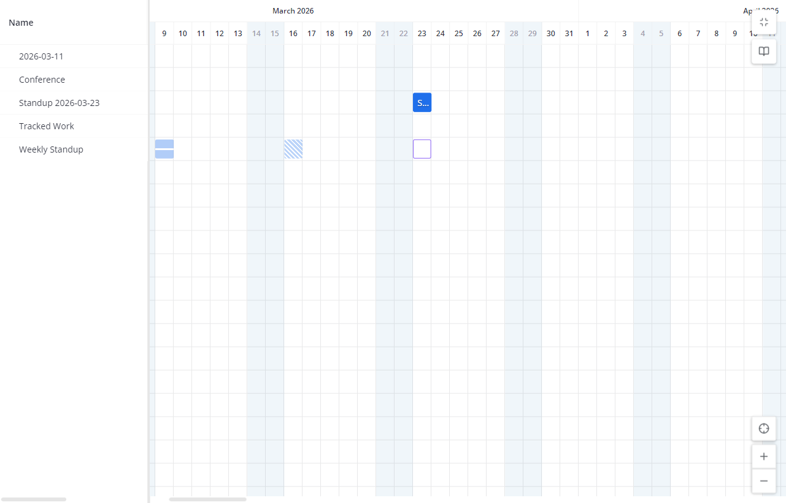
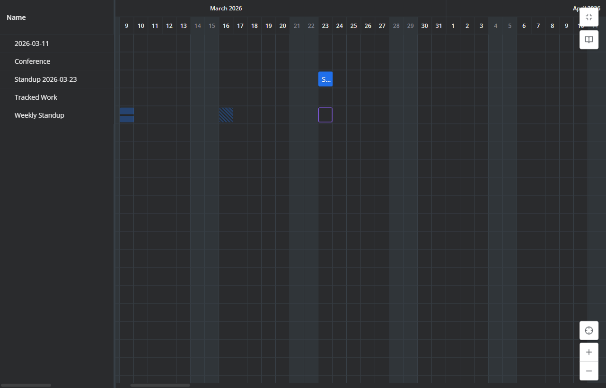

# Calendar items

If you use the TaskNotes calendar, your day is bigger than tasks with
`scheduled`/`due` dates: recurring routines, tracked time, timeblocks, notes
carrying date properties, and subscribed external calendars all show up there.
TaskNotes Gantt can bring every one of those families into the timeline too —
as flat, **read-only** bars, day by day, using the same toggle vocabulary you
already know from the calendar.

!!! tip "Opt-in, not automatic"

    Every family starts **off** in a fresh view, even ones the calendar shows
    by default. Turn on what you want under
    [Settings → Calendar items](../settings/calendar-items.md). One exception —
    see [Recurring task instances](#recurring-task-instances).

## Recurring task instances

*(Companion only.)* Turn on **Show recurring tasks** and the task's row grows a
bar per instance instead of one plain scheduled→due span, using the same
`@tasknotes/model` expansion engine the calendar itself uses.

| State | Look | Meaning |
| --- | --- | --- |
| **Next** | Solid accent bar | The next upcoming occurrence — the row's anchor. |
| **Projected** | Hollow dashed outline | A future pattern occurrence — the pattern's prediction, not a claim. |
| **Completed** | Dimmed, struck through | A recorded completed instance. |
| **Skipped** | Dimmed, hatched | A recorded skipped instance. |
| **Materialized** | Outlined, clickable | Its own occurrence note exists and matches this view's Base query. |

| Light theme | Dark theme |
| --- | --- |
|  |  |

Hover a piece for its date and state. Clicking a **materialized** piece opens
its own note; any other piece opens the parent recurring task.

!!! note "Recorded and materialized instances ignore the master toggle"

    Completed, skipped, and materialized instances render **even with "Show
    recurring tasks" off** — the calendar shows those regardless of its own
    recurring toggle, and the Gantt matches it. The
    [completed/skipped sub-toggles](../settings/calendar-items.md#show-completed-instances)
    still gate them independently.

A materialized note also matches your Base query in its own right, so it
appears **twice** — its own task row, plus the marked piece on the parent's
row. Intentional, not a duplicate.

**Placement rules.** Two occurrences of one task landing on the same day draw
**one piece**, in the higher-precedence state — completed, skipped,
materialized, next, then projected — and hover and click reach that piece.
A materialized piece sits on its note's `scheduled` day, falling back to its
occurrence date. A moved occurrence (a recurring task rescheduled to another
day on TaskNotes 4.15+, see [editing](editing.md#recurring-tasks)) draws
once, on its new day. An occurrence that a TaskNotes calendar with spans
turned on draws across several days is **one day** here.

**Coarse zoom:** pieces only tile at **hour**/**day** zoom. Week/month falls
back to a **dashed spine** across first-to-last instance — never a solid bar,
because a solid bar would claim continuous occupancy the data doesn't have.

**Turning the family off** restores the plain scheduled→due bar; a recorded
instance outside that span still renders alongside it, not instead of it.

## Time entries

*(Companion only.)* One row per **finished** tracked time entry — a still-running
entry (no end time) never renders. An entry crossing local midnight becomes a
two-day bar.

## Timeblocks

Daily-note timeblocks (core **Daily Notes** plugin), one bar per valid block,
day-attributed to its note's own date. A block needs a valid `id` and `HH:MM`
start/end; a malformed one is skipped. Untitled blocks show as
*(untitled block)*.

## Property-based events

Any note matched by **this view's Base query** becomes an event bar, driven by
three property pickers you map — start, end, title — never a hardcoded name.
Start-only is a one-day bar; start+end spans the days between; a blank title
property falls back to the file name.

!!! info "Scoped by the view's own query"

    Property events are rows from this view's Base result, not a separate
    feed. Parity with the calendar holds only when both look at the same set
    of notes.

## External calendars

*(Companion only.)* TaskNotes' own ICS subscriptions and Google/Microsoft
calendar connections, each with its own toggle, listed live under
[Settings → External calendars](../settings/calendar-items.md#external-calendars)
once TaskNotes has at least one configured.

Each provider only ever caches a bounded sync window — the Gantt inherits
whatever's already synced, nothing more:

| Provider | Window | Notes |
| --- | --- | --- |
| **ICS** | Each event's own start to ~1 year ahead | Capped at 3,000 instances per recurring series. |
| **Google** | ~6 months back / 3 ahead | Initial-sync default — incremental sync may add more. |
| **Microsoft** | ~1 month back / 3 ahead | Initial-sync default — incremental sync may add more. |

An event outside its provider's synced window isn't there yet — expected, not
data loss. Each toggle group states its own window on the panel.

A **recurring** external event (an ICS/Google/Microsoft series) collapses to
**one row** spanning its first-to-last occurrence, with only the actual
occupied days piece-marked — the same occupancy rendering
[recurring task instances](#recurring-task-instances) use, gaps included.
It's still one plain read-only bar underneath, not a task: see
[Everything here is read-only](#everything-here-is-read-only).

!!! warning "When a service is unreachable"

    A missing/reshaped TaskNotes calendar service degrades quietly: that
    family's events don't render, the rest of the view keeps working, and you
    get a one-time notice — *"TaskNotes Gantt: some external-calendar services
    are unavailable — their events are not shown."* A gray line also stays
    under **External calendars** for the rest of the session.

    A cold cache instead shows *"Fetching external events…"* in the toolbar
    until the first sync lands — normal startup, not the degrade case. That
    clears on the first completed refresh signal for the visible feeds, even
    when a calendar turns out to be empty; it's a "have we heard back yet?"
    indicator, not an emptiness check.

## Everything here is read-only

Non-task items and a recurring row's occupancy pieces/spine never drag,
resize, or write back — their geometry is derived, not editable. Edit the
underlying task, time entry, timeblock, or note the usual way — through
[the editor](editing.md), the grid, or the note itself.

## Quick source switcher

Hide/show active families instantly, without touching settings. Open with the
**"Quick source switcher…"** command, or the **Sources** button in the
[toolbar](../settings/appearance.md#show-toolbar) (enable **Show toolbar**
first). Keyboard-operable: arrows move, Space/Enter toggles, Escape closes.

It covers **recurring tasks, time entries, timeblocks, property-based events,
and external-calendar events** — an external family counts as active whenever
at least one per-subscription/per-calendar feed is visible in the view, and it
hides/shows instantly through the switcher, exactly like every other source.
Switcher state is **per view, per session**: it survives a refresh of the same
view, resets on reopen, and is never written to the view's settings.

## Requirements

| Family | Needs TaskNotes? |
| --- | --- |
| Recurring task instances, Time entries, External calendars | Yes |
| Timeblocks | No — core Daily Notes plugin only |
| Property-based events | No — reads this view's Base query |

Recurring parity is verified against the recurrence engine TaskNotes **5.0.5**
ships — that is the baseline "identical to the calendar" is measured against.
Older installs still render (the Gantt's only hard version check is TaskNotes'
general compatibility gate); they just may differ from your calendar:

- **TaskNotes 4.11–4.14** predate the model calendar: moved occurrences,
  Google-calendar moved dates, offset-instant `scheduled` days, and the yearly
  look-ahead are absent or differ.
- **TaskNotes 4.15 through 4.x** run an earlier model release — close, but
  small placement differences remain possible.

## Related

- [Settings → Calendar items](../settings/calendar-items.md)
- [Core Concepts → The two modes](../core-concepts.md#the-two-modes)
