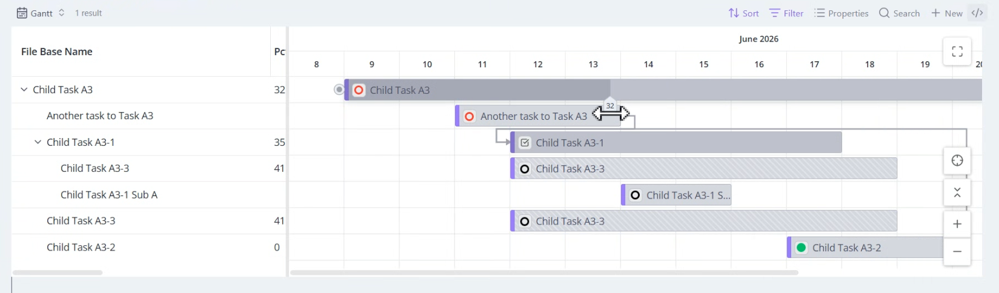

# Editing tasks

*(Companion mode — every edit is written through TaskNotes.)*

The Gantt is a real editor, not just a viewer. You can edit tasks two ways:
through TaskNotes' own UI from the bars, and inline in the grid.

## Bars behave like TaskNotes task cards

- **Click** a bar to select it; clicking it again (or double-clicking) opens the
  note or TaskNotes' **edit modal**, honoring your TaskNotes single-/double-click
  settings.
- **⌘/Ctrl-click** opens the note in a new tab.
- **Right-click** a bar for TaskNotes' **own task context menu** — change status,
  priority, contexts, tags, dates, and more, using the exact same UI as
  everywhere else in TaskNotes.

Because these use TaskNotes' native surfaces, edits behave identically to
editing a task anywhere else.

## Inline editing in the grid

Edit a task's properties without leaving the timeline:

- **Double-click** a grid cell, or select it and press <kbd>F2</kbd>, to edit.
- Editors are **type-aware** — text, numbers, a true/false picker, locale-aware
  dates (with a calendar dropdown), status, priority, and multi-value list fields.
- Property cells render as real **Obsidian markdown**, so wikilinks are clickable
  and tags show as pills.
- A column on a field **TaskNotes owns** (status, due, assignees, and its other
  built-in fields) edits only through the Gantt
  [field mapping](../settings/fields.md) that claims it; a column on an
  unclaimed TaskNotes-owned field is **read-only** — edit it through TaskNotes'
  own task editor instead.

Every inline edit is written through TaskNotes.

| Editing a cell | Date editor | Status picker |
| :---: | :---: | :---: |
|  |  |  |

## Recurring tasks

On TaskNotes 4.15 and later, editing a recurring task's dates records a
**moved occurrence**: TaskNotes writes the new day to `scheduled`, keeps the
original rule day in `recurrence_original_date`, and the occurrence shows
once, on its new day. Editing the dates back onto the rule day clears the
record.

A recurring task's bar drags only while its recurring pieces are **hidden**
([Show recurring tasks](calendar-items.md#recurring-task-instances) off).
With pieces shown, the row's bar is an occupancy envelope and refuses drags —
its dates change through the grid, the edit modal, or the context menu.

## Progress

If a task has progress, the bar can show it — either the completion TaskNotes
computes from a checklist, or a numeric property you map. In property mode you
can **drag the progress handle** to write the value back. See
[Settings → Progress](../settings/progress.md).

| Light theme | Dark theme |
| :---: | :---: |
|  |  |
