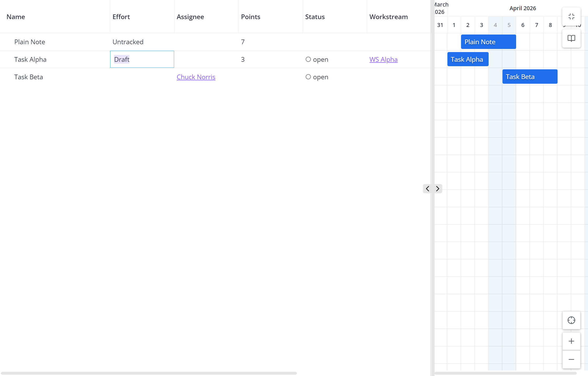
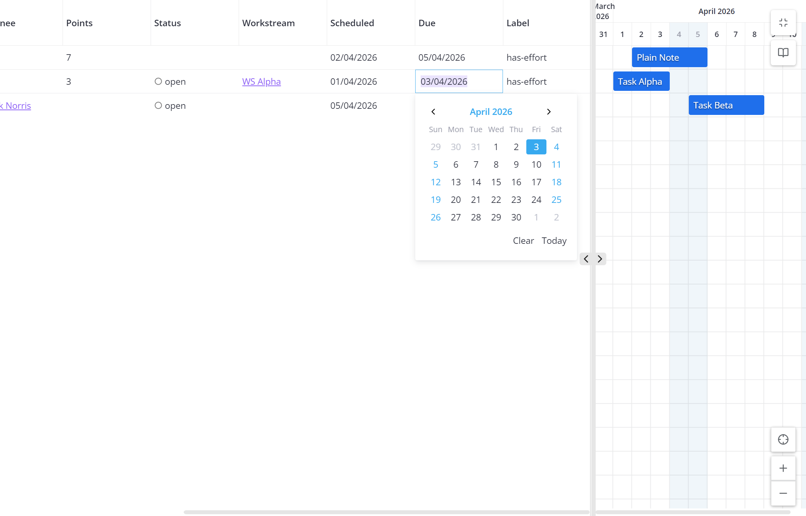
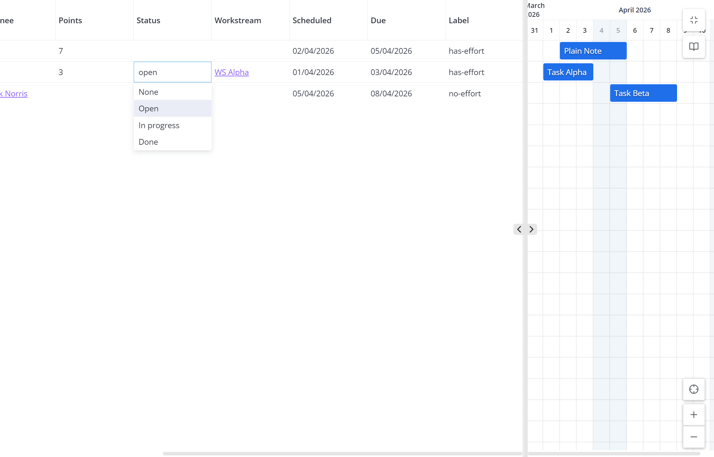
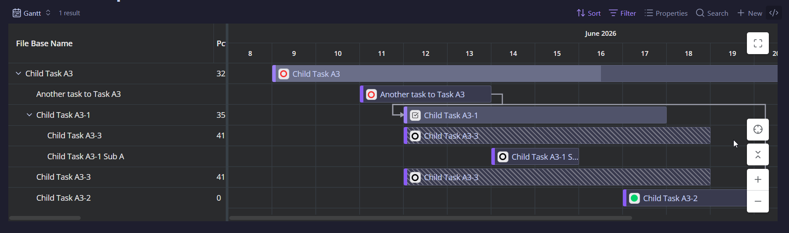

# Editing tasks

*(Companion mode — every edit is written through TaskNotes.)*

The Gantt is a real editor, not just a viewer. You can edit tasks two ways:
through TaskNotes' own UI from the bars, and inline in the grid.

## Bars behave like TaskNotes task cards

- **Click** a bar to select it; clicking it again (or double-clicking) opens the
  note or TaskNotes' **edit modal**, honoring your TaskNotes single-/double-click
  settings.
- **⌘/Ctrl-click** opens the note in a new tab.
- **Right-click** a bar for TaskNotes' **own task context menu** — change status,
  priority, contexts, tags, dates, and more, using the exact same UI as
  everywhere else in TaskNotes.

Because these use TaskNotes' native surfaces, edits behave identically to
editing a task anywhere else.

## Inline editing in the grid

Edit a task's properties without leaving the timeline:

- **Double-click** a grid cell, or select it and press <kbd>F2</kbd>, to edit.
- Editors are **type-aware** — text, numbers, a true/false picker, locale-aware
  dates (with a calendar dropdown), status, priority, and multi-value list fields.
- Property cells render as real **Obsidian markdown**, so wikilinks are clickable
  and tags show as pills.

Every inline edit is written through TaskNotes.

A column that holds a field TaskNotes treats as its own — identified by the
property TaskNotes' field mapping assigns that field — is edited through the
[Gantt field mapping](../settings/fields.md) that claims it (Status, Priority,
Assignees, Start, End, and the rest of the mapped roles). A TaskNotes-owned
column that no mapping claims is **read-only** in the grid; edit it in
TaskNotes' task editor, the bar context menu, or the note.

| Editing a cell | Date editor | Status picker |
| :---: | :---: | :---: |
|  |  |  |

## Rescheduling a recurring task { #rescheduling-a-recurring-task }

*(Companion mode. On TaskNotes 4.15 and later.)*

Changing a recurring task's dates records a **moved occurrence**: `scheduled`
holds the new day and `recurrence_original_date` holds the original rule date.
The occurrence then shows once, on the new day. TaskNotes decides what the
move means; the Gantt passes the new `scheduled` through unchanged. Dragging
the bar back to the original day clears `recurrence_original_date`.

A recurring row's occupancy pieces never drag. Hide **Show recurring tasks**
so the row is a plain scheduled→due bar, then drag that bar. Leave recurring
pieces visible and change dates in the grid, the edit modal, or the context
menu instead.

Verified TaskNotes versions, and how 4.x calendars can differ, are on
[Calendar items → Verified TaskNotes version](calendar-items.md#verified-tasknotes-version).

## Progress

If a task has progress, the bar can show it — either the completion TaskNotes
computes from a checklist, or a numeric property you map. In property mode you
can **drag the progress handle** to write the value back. See
[Settings → Progress](../settings/progress.md).

| Light theme | Dark theme |
| :---: | :---: |
|  |  |
